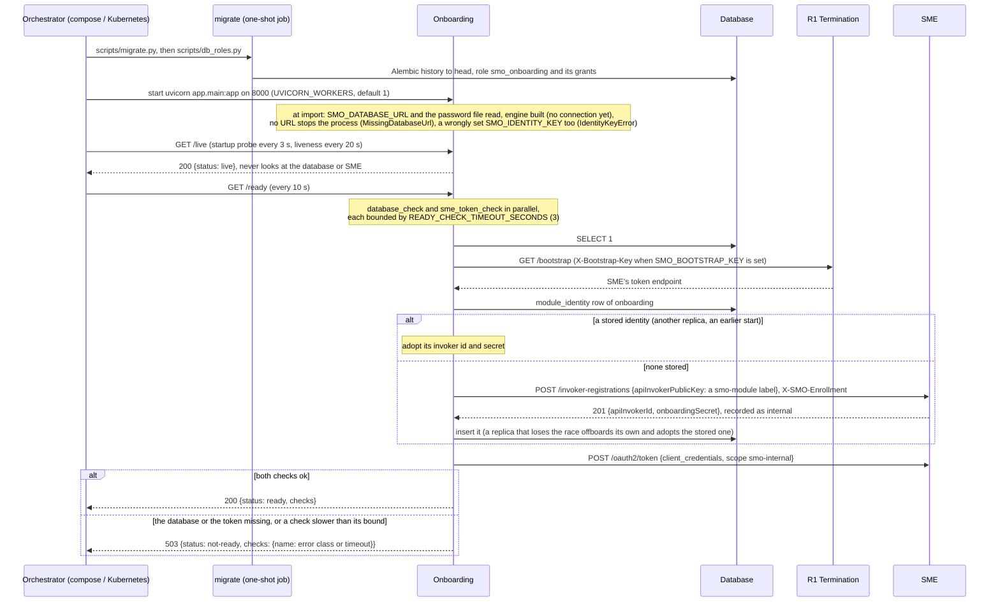
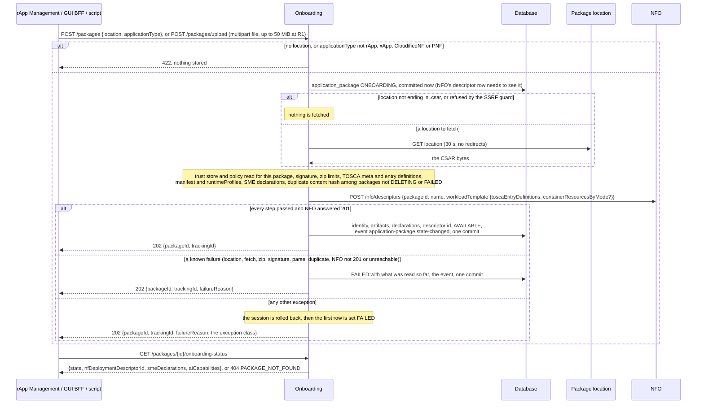
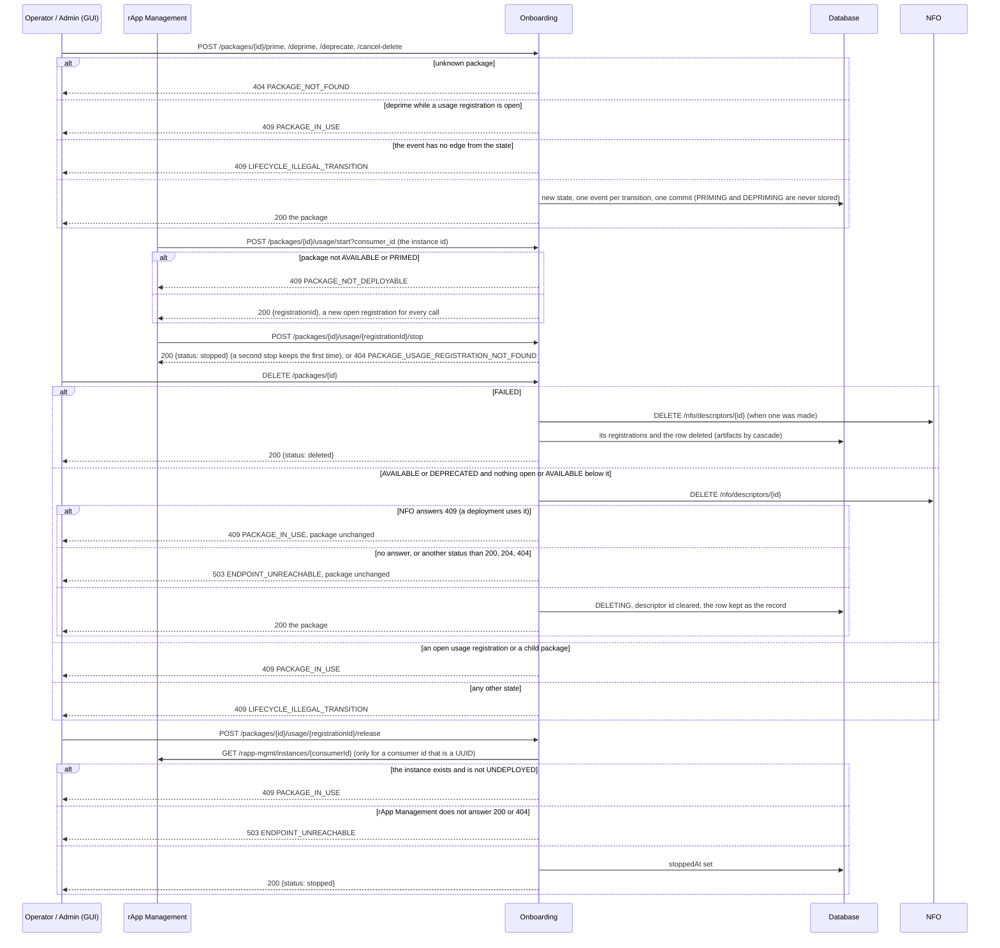
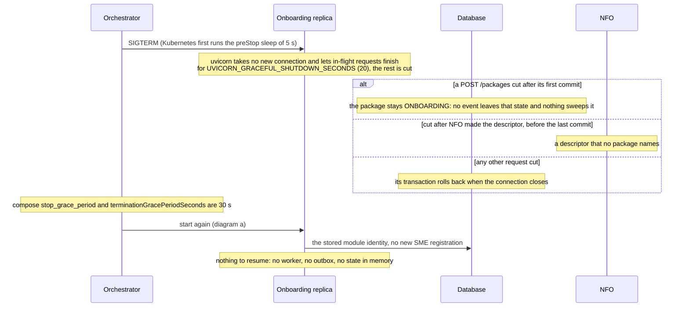

# Onboarding: lifecycle

Onboarding (the Software Package Onboarding SMOS) turns a package location or an uploaded CSAR into a governed rApp package: it validates the package,
asks NFO for the package's NF deployment descriptor, owns the package states and keeps the usage registrations that guard deprime and delete. It is
served behind R1 Termination at `/onboarding`, keeps its tables (`application_package`, `artifact`, `package_usage_registration`) in the database
schema `onboarding` and connects as its own role `smo_onboarding`. The design is in its [README](../README.md); the package flows are call flows
[01a](../../docs/call-flows/01-rapp-onboarding-to-deployment.md) and [06](../../docs/call-flows/06-package-lifecycle.md). This document follows the
module itself, from start to stop. Four diagrams:

| | Step | Who starts it | Ends with |
|---|---|---|---|
| a | Starting and becoming ready | the orchestrator (docker compose, Kubernetes) | a replica that answers `/ready` 200, with the module's identity at SME |
| b | Onboarding a package | rApp Management, the GUI BFF, an operator's script | a package AVAILABLE with its NFO descriptor, or FAILED with a reason |
| c | The package's life: states, usage, delete | Operator and Admin (GUI), rApp Management | the package's new state, an open or closed usage registration, or a refusal |
| d | Stopping, crashing and recovering | the orchestrator, a crash | in-flight requests finished or rolled back, the same identity after a restart |

**How to read the diagrams.** As in call flow 01: an arrow is one call with the inputs that matter, a box on the receiver says what it does with them,
an `alt` block is the outcome (success first, then each failure and what the caller gets). Every call reaches Onboarding through R1 Termination, which
checks the token; an rApp may read packages but change nothing under `/onboarding` (R1 refuses it). Onboarding's own calls to NFO and rApp Management
go through R1 as well (`R1Client`, with the module's token); the package fetch is a plain HTTP GET, not over R1.

## a — Starting and becoming ready

The schema is never created or changed by the service: compose starts it only once `migrate` has completed (`depends_on`), and in Kubernetes the pod
waits in the init container `wait-for-schema` (`migrate.py --wait`) for the chart's migration Job. The module's identity at SME is made lazily, by the
first `/ready` or the first call over R1, and is kept in the shared `module_identity` table, so every replica and every restart use the same invoker
(PR-ST-4); the token is cached and renewed 30 s before it expires, and once after a 401. Onboarding registers nothing else at start: no SME service,
no DME type, no seed data. The compose service mounts a volume at `/srv/packages`, but no code writes to it: package bytes are not kept.

## b — Onboarding a package

The 202 is not asynchronous work: the whole pipeline runs inside the request (a plain `def` route, in uvicorn's thread pool) and the verdict is the
package state. The trust store is read for every package, so a new publisher key needs no restart. `failureReason` is returned once and never
stored. rApp Management reads `onboarding-status` at every create, upgrade and bootstrap; AIMgF reads `aiCapabilities.runtimeProfiles` from it.
**Phase 1:** the duplicate check is a SELECT, not a unique index, so the same CSAR sent twice at the same moment can be onboarded twice.

## c — The package's life: states, usage, delete

rApp Management is the only writer of usage registrations (call flow 06): it opens one before anything else at CreateInstance and closes it at every
teardown, and the deprime and delete guards read nothing else. NFO's refusal of the descriptor delete is the same 409 or 503 for a FAILED package,
which then stays. `release` is the administrator's way out when a teardown's `usage/stop` failed. Every
transition is published on the SMO event feed as `org.oran.smo.application-package.state-changed`; a FAILED package's direct delete is not a
transition and publishes nothing. **Phase 1:** priming provisions nothing, and no route sets `parent_package_id`, so the child-package guard is never
met in practice.

## d — Stopping, crashing and recovering

A replica holds nothing between requests, so any number can run behind R1 Termination. Two replicas writing the same package see each other through
the row version of `application_package` (PR-ST-2): the second write is 409 `CONCURRENT_MODIFICATION`. A database outage makes `/ready` 503 and takes
the replicas out of rotation without restarting them; an SME outage does the same once the cached token expires, since without a token the calls to
NFO and rApp Management are refused by R1. **Phase 1:** a package left ONBOARDING by a crash cannot be deleted (DELETE answers 409
`LIFECYCLE_ILLEGAL_TRANSITION`) and is not retried; onboard the CSAR again (the stuck row has no content hash yet, so it does not block the
duplicate check). The fetch (30 s) and the NFO call (`SMO_HTTP_TIMEOUT_SECONDS`, 30 s) can together outlast the 20 s drain, so a stop during a slow
onboarding is the likeliest way to get there.

## Configuration it reads

| Variable | Default | What it changes |
|---|---|---|
| `SMO_DATABASE_URL`, `SMO_DATABASE_PASSWORD_FILE` | none (required) | the database and the role `smo_onboarding`; without a URL the process does not start |
| `ONBOARDING_TRUST_STORE` | empty | the accepted publishers' public keys, read for each package; empty: no signature is checked |
| `ONBOARDING_REQUIRE_SIGNED_PACKAGES` | `false` | `true`: an unsigned package is FAILED (with no trust store, every package) |
| `R1_GATEWAY_URL` | `http://r1-termination:8000` | where `/bootstrap`, NFO and rApp Management are reached |
| `SMO_ENROLLMENT_SECRET_FILE` | compose secret | makes the module's invoker `internal` at SME (PR-SEC-14) |
| `SMO_BOOTSTRAP_KEY` | unset | sent as `X-Bootstrap-Key` when the gateway asks for it |
| `SMO_INVOKER_ID`, `SMO_INVOKER_SECRET` | unset | a pinned identity instead of the stored one |
| `SMO_MODULE_IDENTITY_STORE` | `db` | `off`: every process registers its own invoker |
| `SMO_IDENTITY_KEY` (`_FILE`) | empty | encrypts the stored identity secret; a wrong value stops the start |
| `SMO_HTTP_TIMEOUT_SECONDS` | `30` | how long a call to NFO or rApp Management waits |
| `READY_CHECK_TIMEOUT_SECONDS` | `3` | how long each `/ready` check may take |
| `UVICORN_WORKERS`, `UVICORN_GRACEFUL_SHUTDOWN_SECONDS` | `1`, `20` | processes per container, and how long a stop lets requests finish |

## Decisions this module depends on

- **The schema belongs to the migration, never to the service** (PR-OPS-1.5, PR-OPS-3.2); the module connects as its own role (PR-DB-2.6).
- **Liveness depends on nothing, readiness on the database and SME** (PR-ST-7): an outage takes a replica out of rotation, it does not restart it.
- **One identity per module, shared by its replicas** (PR-ST-4), registered with the enrollment secret so SME records it as `internal` (PR-SEC-14).
- **Every error while onboarding ends the package FAILED** (call flow 06d, DOC-CF-1.2), and a failed or deleted package never locks its CSAR out
  (OI-2-package-redeploy).
- **The package row is committed before NFO is called**, because NFO's descriptor row must see it under read-committed isolation.
- **Signatures are the operator's choice** (PR-RAPP-1), and every package zip is read within limits (SEC-15.17).
- **A deleted package leaves no descriptor at NFO**, and a usage registration is released only when its instance is gone (call flow 06c).
- **Every state change is on the event feed** through the state machine's listener (PR-MSG-3.5); a stale write is a 409 (PR-ST-2).
