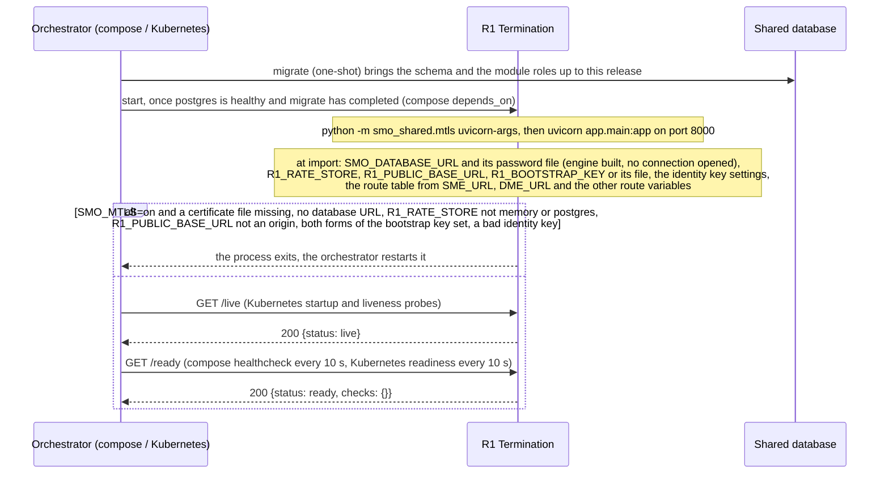
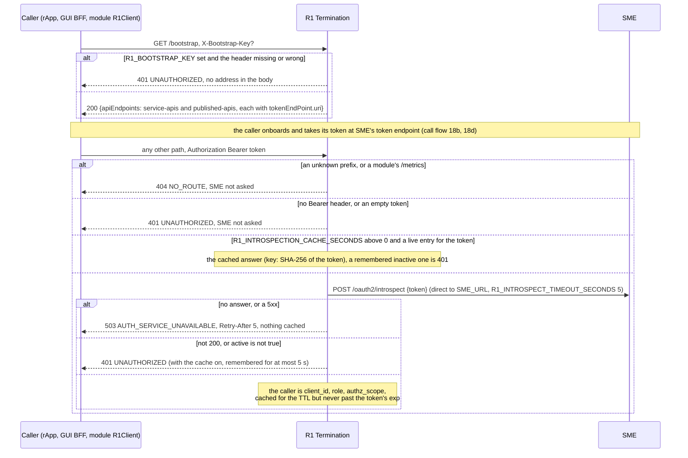
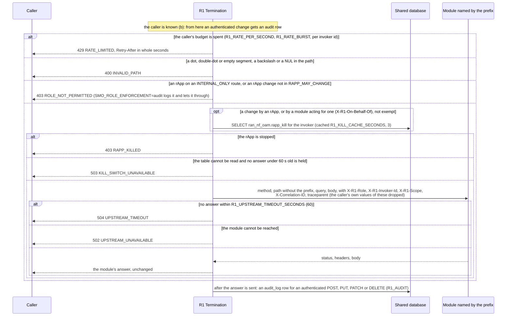
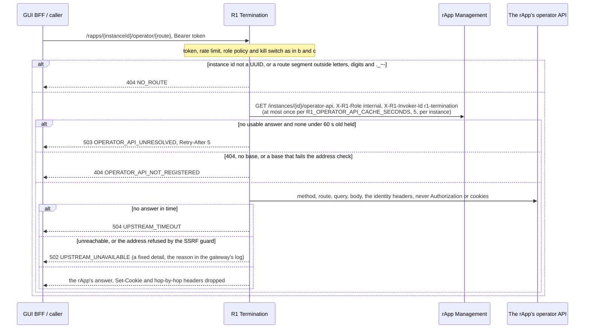
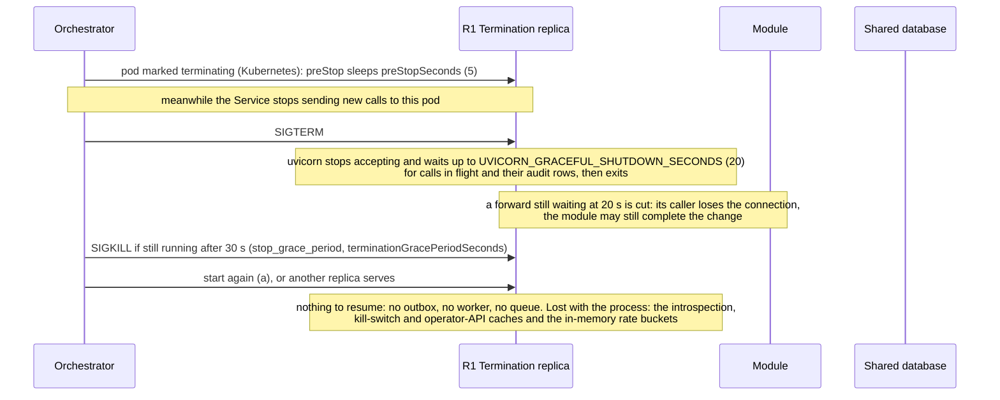

# R1 Termination: lifecycle

R1 Termination is the gateway every rApp, the GUI backend and every SMO module's `R1Client` reaches the other modules through: it checks the bearer
token with SME, applies the role policy, the rate limit and the kill switch, forwards the call to the module named by the first path segment and records
every authenticated change in the audit chain. It is the R1 entry point itself (container `:8000`, host `:8080` in `docker-compose.yml`; its own routes are
`/health`, `/live`, `/ready`, `/version` and `/bootstrap`). It has no database schema of its own: it connects as `smo_r1_termination`, writes the shared
`audit_log` and `audit_head` (and `rate_bucket` with `R1_RATE_STORE=postgres`) and reads RAN NF OAM's `ran_nf_oam.rapp_kill`
(`migrations/db_roles.json`). Design record: [README](../README.md). Five diagrams:

| | Step | Who starts it | Ends with |
|---|---|---|---|
| a | Starting and becoming ready | the orchestrator (compose, Kubernetes) | a process that answers its probes, or one that exits on a bad setting |
| b | Bootstrap and the token check | an rApp, the GUI BFF, a module's `R1Client` | the caller's invoker id, role and scope claim, or 401 / 503 |
| c | Forwarding a call | any authenticated caller | the module's own answer, or the gateway's refusal, and an audit row for a change |
| d | The operator API of a rApp instance | the GUI BFF, an rApp | the call forwarded to the base the instance registered at rApp Management |
| e | Stopping, crashing and recovering | the orchestrator, a crash | calls in flight finished or cut, the in-memory caches lost, nothing to resume |

**How to read the diagrams.** As in call flow 01: an arrow is one call with the inputs that matter, a box on the receiver says what it does with them,
an `alt` block is the outcome (success first, then each failure and what the caller gets). The gateway's own refusals are `{title, status, detail}` at the
top level (not the modules' `{"detail": {...}}`); everything else is the module's answer passed through unchanged.

## a — Starting and becoming ready

The gateway registers nothing and has no identity at SME: it introspects tokens without one (call flow 18d) and asks rApp Management for an operator API as
an internal caller by header (d). Its `/ready` has no checks, so it is ready whenever it is live: SME being down shows as 503 `AUTH_SERVICE_UNAVAILABLE` on
proxied calls and as the modules' own `/ready` failing, the database being down as failed audit writes (counted, never refused) and, for a change by an
rApp, 503 `KILL_SWITCH_UNAVAILABLE` (c). The probes and `/bootstrap` are answered before the catch-all route, so they need no token.

**Phase 1:** the gateway cannot start without `SMO_DATABASE_URL` even with `R1_AUDIT=off`: the audit and rate-limit code import the shared database module,
which refuses an unset URL at import.

## b — Bootstrap and the token check

The URIs in `/bootstrap` name SME on the container network (`SME_URL`), or, with `R1_PUBLIC_BASE_URL` set, `<base>/sme/...` with the token endpoint at
`<base>/sme/oauth2/token`, the one path the TLS edge forwards to SME without a token. A role SME does not report is read from the token's scope
(`smo-internal`, `smo-gui`: internal; anything else: rapp), and a scope claim that cannot be read permits nothing.

**Revocation and the cache.** After a 2xx answer that went through this replica, the gateway forgets cached answers at once: `DELETE
/sme/invoker-registrations/{id}` and `PUT /sme/invoker-registrations/{id}/authz-scope` evict that invoker, a `POST
/sme/invoker-registrations/purge-stale` clears the cache; a generation number keeps an introspection that was in flight from storing its older answer.
Another replica, or a change made at SME without the gateway, is seen after at most the TTL. **Phase 1:** the cache is per replica; compose and the chart set
30 s, the code's own default is 0 (off).

## c — Forwarding a call

Ahead of all this the body cap answers 413 `PAYLOAD_TOO_LARGE` (`R1_MAX_BODY_BYTES`, 1 MiB; 50 MiB for the model artifact and rApp package uploads), and a
header outside ASCII is 400 `HEADER_NOT_ASCII` instead of a forward. The kill switch leaves DELETE, the token endpoint and a config job's rollback and
creation alone (RAN NF OAM refuses and records a stopped rApp's config job itself). An `X-R1-On-Behalf-Of`, `X-R1-On-Behalf-Scope`, `X-R1-Acting-User` or
`X-R1-Acting-User-Scope` is forwarded from an `internal` caller only. With `R1_DEMO_RAPP_PM_REPORTS=on` an rApp may also `POST /ran-nf-oam/pm-reports`, each
call logged as a warning.

The audit row is written as a background task after the answer, so a slow or unreachable database fails no call; a failed write is logged and counted
(`smo_audit_writes_total{outcome="failed"}`). The row holds the caller, its role, the method, the path cut at `?`, the result (the status, or
`REFUSED:ROLE_NOT_PERMITTED` / `REFUSED:RAPP_KILLED`) and the correlation id, never the body. Reads, unauthenticated calls and 503s of the token check are not
recorded. Call flow 14 follows the correlation id through the forward.

## d — The operator API of a rApp instance

A rApp onboarded at run time is reachable here with no route-table entry and no restart. The base is a URL a workload supplied, so it is checked when
rApp Management stores it and again before every call (`smo_shared/webhook.py`). Nothing of the rApp's address or of an exception reaches the caller.

## e — Stopping, crashing and recovering

The gateway never retries a forward: a call cut by a crash or a stop is the caller's to retry, and whether the module had already made the change is the
module's answer to the retry. An audit row not yet written when the process dies is lost; the chain stays whole, because each row is numbered under a lock
on the `audit_head` row in its own transaction. A restart costs SME one introspection per token again and resets the in-memory rate budgets.

**Several replicas** (`docker-compose.replicas.yml`, two; the chart's `replicas` or its autoscaler): each keeps its own caches, so a revocation through
one replica is seen by the others after `R1_INTROSPECTION_CACHE_SECONDS`, a kill switch after `R1_KILL_CACHE_SECONDS` and an operator API change after
`R1_OPERATOR_API_CACHE_SECONDS`. With `R1_RATE_STORE=memory` (the default) a caller has N times the budget; `postgres` keeps one budget in `rate_bucket`
and, when the database errs, falls back to the replica's own bucket for 5 s (it fails open, where the kill switch fails closed). The audit chain is one
across replicas.

## Configuration it reads

| Variable | Default | What it changes |
|---|---|---|
| `SMO_DATABASE_URL`, `SMO_DATABASE_PASSWORD_FILE` | none (required) | The database for the audit chain, the kill switch and the shared limiter; read at import |
| `SME_URL` and the other route variables (`DME_URL`, ...) | `http://<module>:8000` | Where each prefix is forwarded; `SME_URL` is also the introspection target and the address `/bootstrap` names |
| `R1_PUBLIC_BASE_URL` | unset | The origin `/bootstrap` advertises instead of `SME_URL`; checked at start |
| `R1_BOOTSTRAP_KEY` / `R1_BOOTSTRAP_KEY_FILE` | unset | `/bootstrap` asks for `X-Bootstrap-Key`; read at start, both set stops the process |
| `R1_INTROSPECT_TIMEOUT_SECONDS` | `5` | How long the token check waits for SME before 503 |
| `R1_INTROSPECTION_CACHE_SECONDS` | `0` (`30` in compose and the chart) | How long an answer of SME is reused; read on every call |
| `R1_INTROSPECTION_CACHE_MAX_ENTRIES` | `10000` | Size of that cache; read at start |
| `R1_UPSTREAM_TIMEOUT_SECONDS` | `60` | How long a forward waits for the module before 504 |
| `R1_RATE_PER_SECOND`, `R1_RATE_BURST` | `100`, `200` | Each caller's budget; `0` rate turns the limiter off |
| `R1_RATE_STORE` | `memory` | `postgres` shares the budget across replicas; read at start, another value stops the process |
| `SMO_ROLE_ENFORCEMENT` | `enforce` | `audit` counts and logs an rApp's refused call and lets it through |
| `R1_KILL_SWITCH`, `R1_KILL_CACHE_SECONDS`, `R1_KILL_SWITCH_SCHEMA` | `on`, `3`, unset (`ran_nf_oam` in compose and the chart) | Whether and how often the gateway reads `rapp_kill`, and in which schema |
| `R1_OPERATOR_API_CACHE_SECONDS` | `5` | How long an instance's operator API base is reused |
| `R1_AUDIT` | `on` | `off` writes no audit rows |
| `R1_DEMO_RAPP_PM_REPORTS` | `off` | `on` lets an rApp `POST /ran-nf-oam/pm-reports` (demo stacks) |
| `R1_MAX_BODY_BYTES`, `R1_MAX_BODY_OVERRIDES` | 1 MiB, two 50 MiB uploads | The body cap, read on every request |
| `SMO_MTLS` | `off` | `on`: serves HTTPS with client certificates, forwards and introspects over mutual TLS, refuses to start without its files |
| `UVICORN_GRACEFUL_SHUTDOWN_SECONDS` | `20` | How long a stopping process waits for calls in flight |

## Decisions this module depends on

- **The token check fails closed** (HISTORY.md §2, call flow 18d): SME not answering is 503 `AUTH_SERVICE_UNAVAILABLE` with `Retry-After`, never a forward
  and never a cached answer; a 401 means the token was found bad.
- **Opaque tokens, introspected** (call flow 18d): no IdP signs JWTs, so the gateway asks SME; the optional cache (PR-SEC-5.4, 30 s by the owner's choice,
  PR-SEC-5.5) bounds how late a revocation is seen.
- **The gateway vouches for identity**: every `X-R1-*` identity and scope header a caller sends is dropped and replaced (PR-SEC-14, PR-SEC-10.3); an rApp
  changes only what `RAPP_MAY_CHANGE` lists and never reaches `INTERNAL_ONLY` or `/sme/oauth2/introspect` (DOC-CF-1.8).
- **A stopped rApp changes nothing** (AI-10.4), and the switch fails closed; the shared limiter fails open (PR-SEC-8.5).
- **Every authenticated change is audited after the answer** (PR-SEC-11), never holding the body and never failing the call.
- **`/bootstrap` stays open and URI-stable** (Foundational Platform LLD section 4.1), narrowed by the optional key (PR-SEC-9.3) and an advertised public
  base (PR-SEC-1.6).
- **A rApp's operator API is resolved per instance** (GUI-8.3), not a route-table entry.
- **Probes and stopping** (PR-ST-7, PR-ST-6): `/ready` separate from `/live`, a 20 s drain inside a 30 s grace period, explicit outbound timeouts that nest
  (a module's 30 s inside the gateway's 60 s).
- **The correlation id starts here** (call flow 14a).
