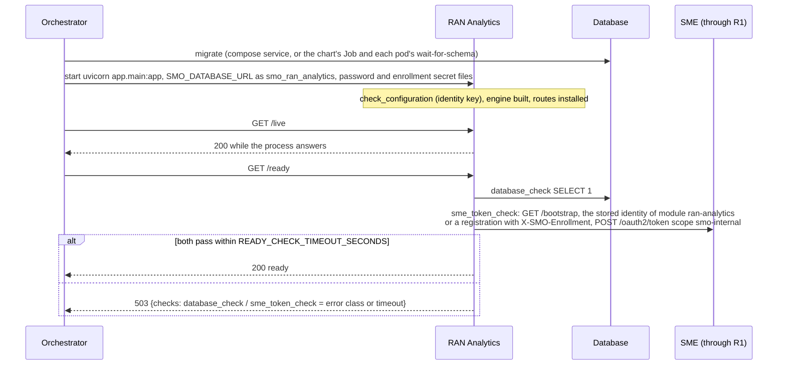
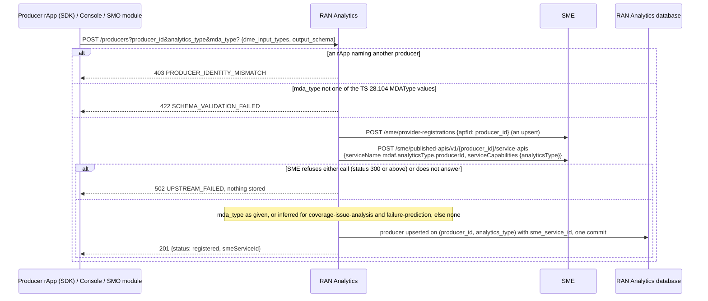
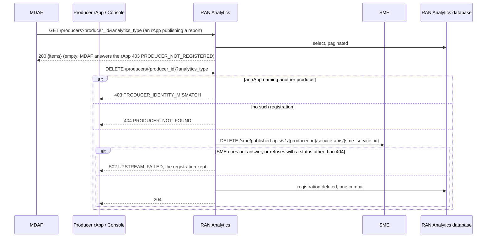
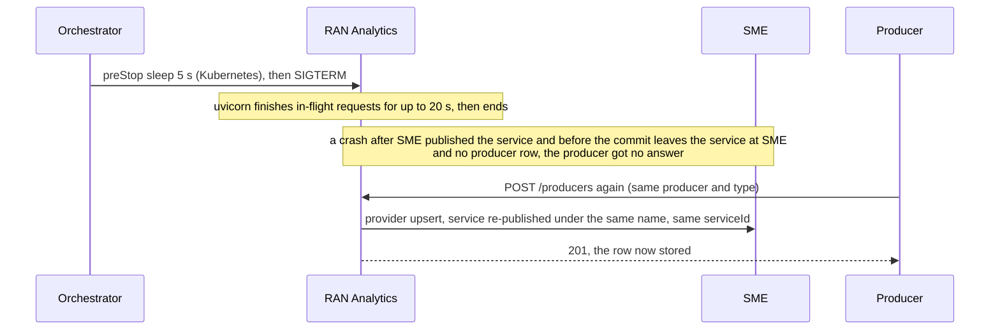

# RAN Analytics: lifecycle

RAN Analytics is the registry of analytics producers: each registration says which analytics type a producer publishes, which DME input types it reads
and the schema of its output, and makes the producer discoverable at SME. MDAF asks it whether an rApp publishing a report is a registered producer of
that type. It is reached at the R1 prefix `/ran-analytics` through R1 Termination, keeps its one table `mdaf_producer` in the database schema
`ran_analytics` (role `smo_ran_analytics`), and has no worker. What each route does is in [`../README.md`](../README.md). Four diagrams:

| | Step | Who starts it | Ends with |
|---|---|---|---|
| a | Starting and becoming ready | the orchestrator (compose, Kubernetes) | a ready replica |
| b | Registering a producer | a producer rApp (SDK), the console, an SMO module | the producer enrolled and its service published at SME, then stored |
| c | Being asked, and deregistering | MDAF, the console, the producer | the producer check answered, or the service withdrawn and the row removed |
| d | Stopping, crashing and recovering | the orchestrator, a crash | a retried registration that lands on the same SME service |

**How to read the diagrams.** As in the call flows: an arrow is one call with the inputs that matter, a box on the receiver says what it does with them,
an `alt` block is the outcome (success first, then each failure and what the caller gets). Calls reach RAN Analytics through R1 Termination, which stamps the
caller's role and invoker id; RAN Analytics' calls to SME go back through R1 with its own token, as an SMO module, so SME lets it act for the producer.
It sends no notifications and has no outbox.

## a — Starting and becoming ready

At start RAN Analytics registers only its own invoker (shared by its replicas, PR-ST-4). The SME check belongs in readiness: every registration needs
SME, and without a token SME's answer through R1 is 401, which b turns into 502.

## b — Registering a producer

SME is asked before the row is written, so every stored producer is discoverable. A producer that registers again (after its own restart, say) is
updated in place, here and at SME, where the same producer re-publishing the same name keeps its `serviceId`. The DME input type ids are stored as sent,
not looked up. The whole flow is [call flow 08a](../../docs/call-flows/08-ran-analytics-data-production.md); SME's side is
[call flow 18a](../../docs/call-flows/18-sme-trusted-invokers-lifecycle.md).

## c — Being asked, and deregistering

The reports a producer published stay at MDAF; once deregistered, an rApp may not publish more of that type ([call flow 08c](../../docs/call-flows/08-ran-analytics-data-production.md)).
The provider registration at SME is left in place: only the service is withdrawn. A registration from before revision 0056 has no `sme_service_id` and
is removed without calling SME.

## d — Stopping, crashing and recovering

Nothing is resumed after a restart: there is no periodic work and no outbox, and the producer's retry is what repairs a half-done registration. A crash
during a deregistration that withdrew the service and did not commit leaves the row with a service SME no longer has; repeating the delete succeeds
because SME answers 204 (or 404) for it. Replicas share only the database; of two first registrations of the same producer and type at the same
moment, the second to commit loses on the primary key and is answered 409 `RESOURCE_ALREADY_EXISTS` (its repeat is an update).

## Configuration it reads

| Variable | Default | What it changes |
|---|---|---|
| `SMO_DATABASE_URL`, `SMO_DATABASE_PASSWORD_FILE` | none (required) | the database; without it the process does not start |
| `R1_GATEWAY_URL` | `http://r1-termination:8000` | where the calls to SME (provider, publish, withdraw, bootstrap) go |
| `SMO_ENROLLMENT_SECRET_FILE` | unset | makes SME record RAN Analytics as an SMO module, which may enrol a producer for an rApp |
| `SMO_BOOTSTRAP_KEY` | unset | sent to `/bootstrap` when the gateway asks for one |
| `SMO_IDENTITY_KEY` (or `_FILE`) | unset | encrypts the stored invoker secret, a wrong value stops the process |
| `READY_CHECK_TIMEOUT_SECONDS` | 3 | how long `/ready` waits for the database and SME |
| `SMO_HTTP_TIMEOUT_SECONDS` | 30 | the bound on each call to SME |

## Decisions this module depends on

- **A stored producer is discoverable** (call flow 08a, DOC-CF-1.8): SME is asked first, a refusal is 502 with nothing stored.
- **One SME service per producer and type** (`mdaf.<analyticsType>.<producerId>`): a shared name made a second producer of a type undiscoverable.
- **An rApp registers and deregisters only itself** (call flow 08a, call flow 18a: SMO modules act for others).
- **`mda_type` is optional and never guessed** (HISTORY.md §7, the `analytics_type` finding).
- **One identity per module** (PR-ST-4); readiness is the database and SME (PR-ST-7).
