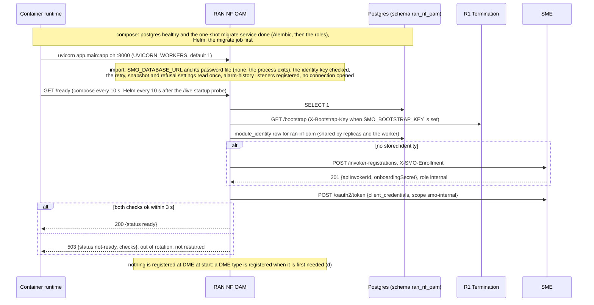
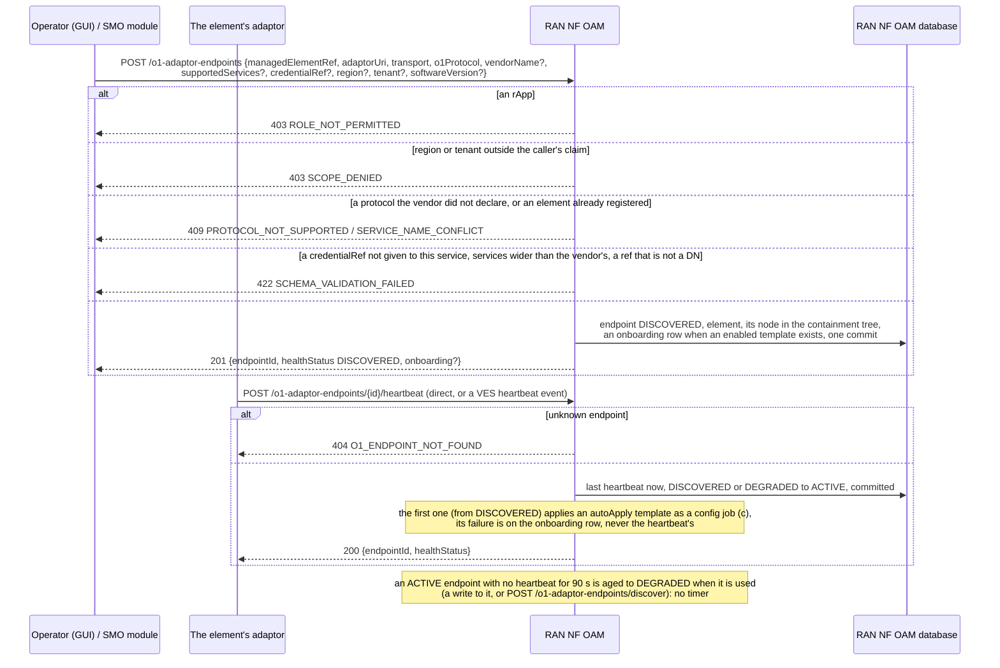
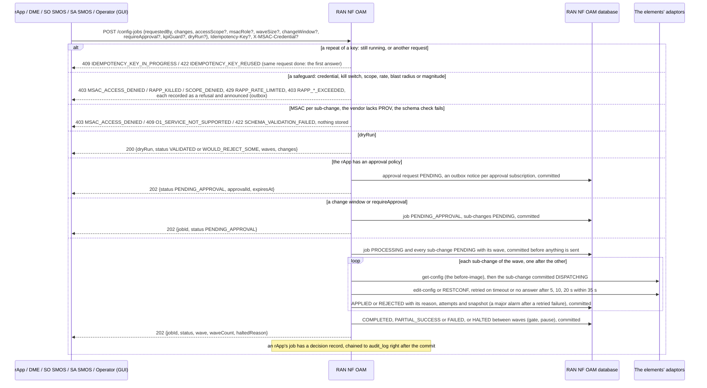
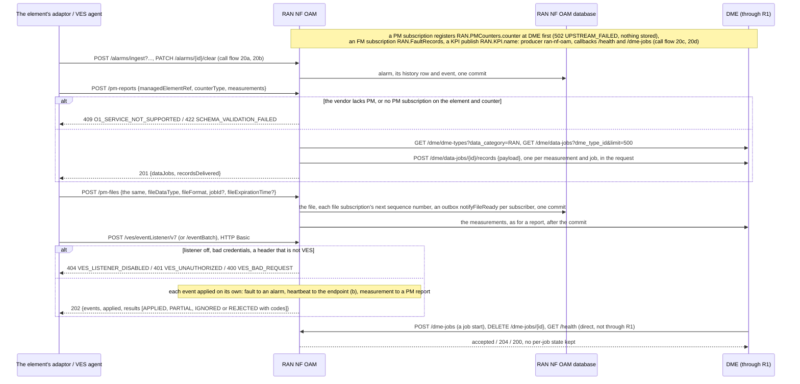
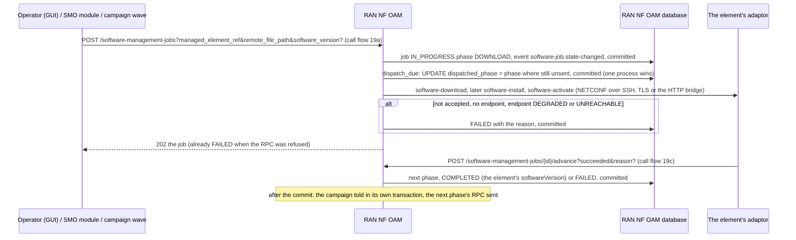
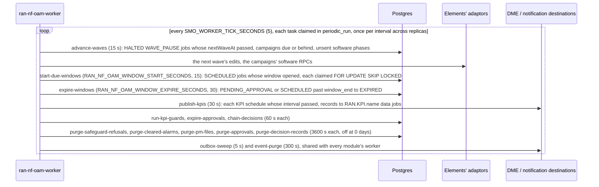
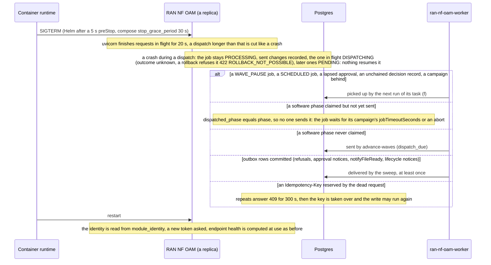

# RAN NF OAM: lifecycle

RAN NF OAM is the one module that speaks O1 to RAN functions: it keeps the registry of managed elements and their O1 adaptors, checks and dispatches
configuration writes (NETCONF or RESTCONF), keeps alarms, carries PM, files and software jobs, and is the DME producer of the elements' measurements. It is
reached at the R1 prefix `/ran-nf-oam` through R1 Termination (the elements' adaptors and the VES listener call it directly), keeps its tables in the
database schema `ran_nf_oam` (role `smo_ran_nf_oam`, which also uses the shared `module_identity`, `notification_outbox`, `idempotency_key`,
`periodic_run`, `audit_log`, `audit_head` and `smo_event`; R1 Termination reads its `rapp_kill` table), and runs as two processes from one image: the
request service `ran-nf-oam` and the worker `ran-nf-oam-worker`. Its design is in [`../README.md`](../README.md). Seven diagrams, grouped by purpose; the
call flows hold the detail of each request:

| | Step | Who starts it | Ends with |
|---|---|---|---|
| a | Starting and becoming ready | the container runtime, the first readiness probe | a replica that answers `/ready` 200, with the module's identity at SME |
| b | Elements, adaptors and their health | Operator (GUI), an SMO module, the element's adaptor | an element registered behind its adaptor, kept ACTIVE by heartbeats |
| c | CM writes and config jobs | an rApp (SDK, or through DME), SO SMOS, SA SMOS, Operator (GUI) | refused, held, or a job whose sub-changes are each committed before and after their edit |
| d | FM, PM, files and VES in, DME out | the element's adaptor or VES agent, Operator (GUI), DME | alarms kept, measurements delivered to DME data jobs, files kept and announced |
| e | Software jobs and campaigns | Operator (GUI), an SMO module, a campaign, the adaptor | each phase's RPC sent once, reported, the job ended |
| f | The worker (`app/tasks.py`) | `ran-nf-oam-worker` | the due work done once per interval across replicas |
| g | Stopping, crashing and recovering | the container runtime, a crash | what the worker re-does, and what is left for a person |

**How to read the diagrams.** As in the call flows: an arrow is one call with the inputs that matter, a box on the receiver says what it does with them,
an `alt` block is the outcome (success first, then each failure and what the caller gets). Calls through R1 Termination carry the caller's role, invoker
id, scope claim and, for the console, `X-R1-Acting-User`. A notification to a caller-supplied URL is an outbox row committed with the change; a state
change of a config job, software job or alarm is an event on the SMO feed in the same commit (`docs/EVENTS.md`).

## a — Starting and becoming ready

The VES listener's password (`RAN_NF_OAM_VES_PASSWORD[_FILE]`) and the NETCONF credentials (`NETCONF_SSH_*`, `NETCONF_CRED_<REF>_*`, `NETCONF_TLS_*`) are
read when they are used, not at start. With `SMO_MTLS=on` the callbacks it registers at DME and the gateway are `https://`. The worker (f) starts the same
way without a port: it checks the identity key, loads `app/tasks.py` and touches `/tmp/worker-heartbeat` every tick.

## b — Elements, adaptors and their health

Vendors and their CM schemas are registered before or after the elements, by an admin (`PUT /vendor-capabilities/{vendor}`, `POST /cm-schemas`,
`POST /vendor-onboarding`, which reads the adaptor's `GET /capabilities`); each registry change is an event on the feed. Call flow
[21](../../docs/call-flows/21-o1-vendor-onboarding.md) walks registration, schemas and the two checks every O1 operation passes. **Phase 1:** there is no MnS
registry to poll; an adaptor (or the operator) registers itself, and `UNREACHABLE` is defined but fired by no route.

## c — CM writes and config jobs

The dispatch runs inside the request: one sub-change can take 65 s (95 s with the before-image read), and R1 answers 504 after 60 s while the request goes
on. Approving, rejecting and lapsing a held request, the change-window runner, waves, rollback and the KPI guard are call flow
[03](../../docs/call-flows/03-config-write-with-schema-check.md) (03b to 03e); DME's path with its idempotency key is 03f. An onboarding template is
written through the same `_execute_write` as any request.

## d — FM, PM, files and VES in, DME out

The PM fan-out is synchronous and not queued: what DME refuses is not retried, and a DME failure is not caught (the report fails). **Phase 1:** streaming
reporting is absent, and an FM subscription registers `RAN.FaultRecords` without RAN NF OAM ever delivering an alarm as a DME record.

## e — Software jobs and campaigns

A campaign (`POST /software-campaigns`) starts one job per element of a wave, gates each wave on failed jobs and new alarms, halts, pauses, rolls back and
notifies `/lifecycle-subscriptions` through the outbox; the worker continues elapsed pauses, times out jobs that never reported (`jobTimeoutSeconds`) and
catches campaigns up. Call flow [19](../../docs/call-flows/19-software-management-job-lifecycle.md) walks the job, and `../README.md` (PR-MGT-15) the
campaign.

## f — The worker (`app/tasks.py`)

A task finds what is due in the database and commits in steps, so it may run again after a crash. A refused start in the window runner ends the job
`FAILED` `START_REFUSED`; an unexpected error is counted on the job and the fifth in a row (`RAN_NF_OAM_WINDOW_START_ATTEMPTS`) ends it `START_ERROR_LIMIT`.
A failed task waits `SMO_WORKER_FAILURE_BACKOFF_SECONDS` (30) on that worker. The worker dispatches like a request does, so one long wave delays its other
tasks on that worker, not on another. The same sweeps are routes for an external scheduler: `POST /config-jobs/advance-due`,
`/software-campaigns/advance-due`, `/rapp-approvals/expire-due`.

## g — Stopping, crashing and recovering

The request process keeps nothing between requests but its token, so any number of replicas may run; two writers of one job are kept apart by its
`row_version` (409 `CONCURRENT_MODIFICATION`) and the sweeps by `FOR UPDATE SKIP LOCKED`. A PM report cut part way leaves some data jobs with its records
and others without, and no one resends it. An element onboarding cut after `APPLYING` was committed stays `APPLYING`: no event leaves that state but the end
of the apply. A PM or FM subscription cut after DME accepted it leaves a DME registration with no subscription; subscribing again is idempotent at DME.

## Configuration it reads

| Variable | Default | What it changes |
|---|---|---|
| `SMO_DATABASE_URL`, `SMO_DATABASE_PASSWORD_FILE` | none, required | The `ran_nf_oam` schema as `smo_ran_nf_oam`; without a URL the process does not start |
| `SMO_ENROLLMENT_SECRET_FILE`, `R1_GATEWAY_URL`, `SMO_BOOTSTRAP_KEY` | compose secret, `http://r1-termination:8000`, unset | Its identity at SME and how DME is reached (a) |
| `SMO_IDENTITY_KEY` (or `_FILE`) | unset | Encrypts the stored identity; set wrongly, neither process starts |
| `RAN_NF_OAM_NETCONF_RETRY_DELAYS`, `RAN_NF_OAM_DISPATCH_RETRY_BUDGET_SECONDS` | `0,5,10,20`, `35` | The attempts of one sub-change and their time budget (c) |
| `RAN_NF_OAM_CM_SNAPSHOTS` | `true` | The before-image read and `cm_snapshot` rows (c) |
| `RAN_NF_OAM_ENFORCE_MO_TREE` | off | Refuse a write whose target is not in the containment tree |
| `RAN_NF_OAM_MSAC_REACH` | off | MSAC also guards reads, subscriptions, alarm changes and software jobs |
| `RAN_NF_OAM_VES_PASSWORD` (or `_FILE`), `RAN_NF_OAM_VES_USERNAME` | unset, `ves` | The VES listener exists only with a password (d) |
| `NETCONF_SSH_KNOWN_HOSTS`, `NETCONF_CRED_<REF>_*`, `NETCONF_TLS_*` | unset | Host keys and credentials for ssh and tls endpoints, read at use |
| `SAFEGUARD_EVENT_MIN_INTERVAL_SECONDS` | `60` | How often one rApp's same refusal is announced |
| `RAN_NF_OAM_WINDOW_START_SECONDS`, `RAN_NF_OAM_WINDOW_EXPIRE_SECONDS`, `RAN_NF_OAM_WINDOW_START_ATTEMPTS` | `15`, `30`, `5` | Worker: the change-window runner, read at worker start |
| `RAN_NF_OAM_KPI_GUARD_GRACE_MINUTES`, `RAN_NF_OAM_KPI_MAX_FILES` | `60`, `2000` | The KPI guard's patience and how many PM files a KPI reads |
| `SAFEGUARD_REFUSAL_RETENTION_DAYS`, `SMO_RETENTION_ALARMS_DAYS`, `SMO_RETENTION_PM_FILES_DAYS`, `SMO_RETENTION_APPROVALS_DAYS`, `SMO_RETENTION_DECISION_RECORDS_DAYS` | `0` each | Worker: the hourly purges; 0 keeps everything |
| `IDEMPOTENCY_IN_PROGRESS_SECONDS` | `300` | When a reservation left by a dead request is taken over (g) |
| `SMO_WORKER_TICK_SECONDS`, `SMO_WORKER_FAILURE_BACKOFF_SECONDS` | `5`, `30` | Worker: how often it looks, how long it leaves a failed task |
| `UVICORN_WORKERS`, `UVICORN_GRACEFUL_SHUTDOWN_SECONDS` | `1`, `20` (Dockerfile) | Processes per container, and the drain on stop |

## Decisions this module depends on

- **Commit before send** (call flow 03c, DOC-CF-1.8): a job and its sub-changes exist before any edit goes out, each edit is bracketed by commits, and an
  unknown outcome is recorded as `DISPATCHING`, never guessed.
- **Retry only transient failures, inside the request, within a budget** (Wave 10.1 W10-19, `PR-ST-9`); an `<rpc-error>` is final.
- **Safeguards before anything is recorded** (`AI-10`, `PR-SEC-10`, `SEC-15.6`): kill switch, scope, rate and change limits, MSAC; a refusal is recorded and
  announced.
- **Periodic work only in the worker** (`PR-MSG-4`): waves, change windows (`MGT-4.4`, `MGT-4.5`), approvals (`AI-11.3`), decision chaining (`AI-13.1`), KPI
  schedules and guards, purges; endpoint health is aged at use, never on a timer.
- **A subscription is a DME producer registration, DME first** (call flow 11a, 20c, 20d).
- **A software phase is sent once, after the commit that made it due** (call flow 19b).
- **The vendor's services and schemas decide** (call flow 21; Wave 9 W9-01, W9-02).
- **Notifications through the outbox, state changes on the event feed** (`PR-MSG-1`, `MSG-3.5`, `MSG-3.6`, `MGT-8.2`).
- **One identity per module** (`PR-ST-4`, `PR-SEC-14`); probes from the shared library (`PR-ST-7`).
