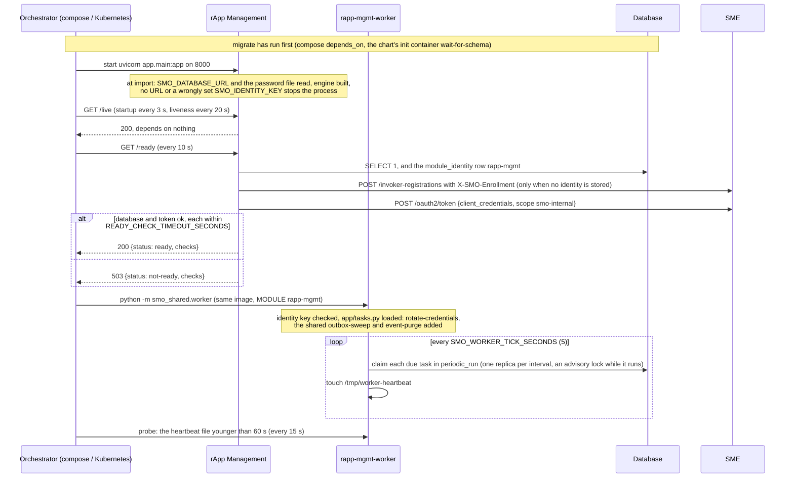
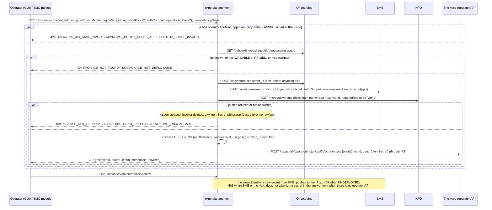
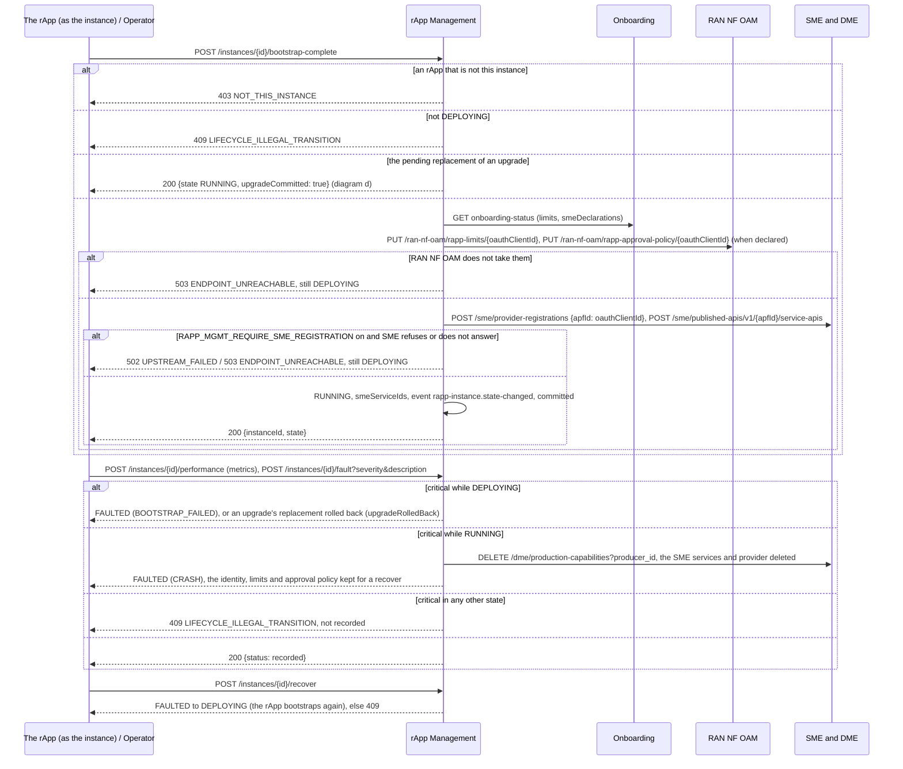
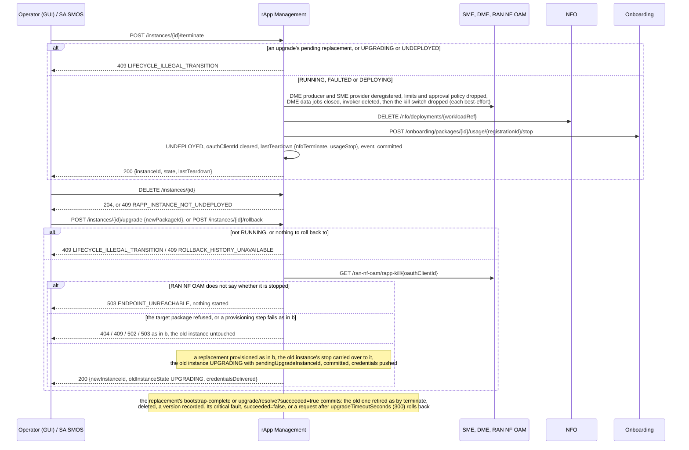
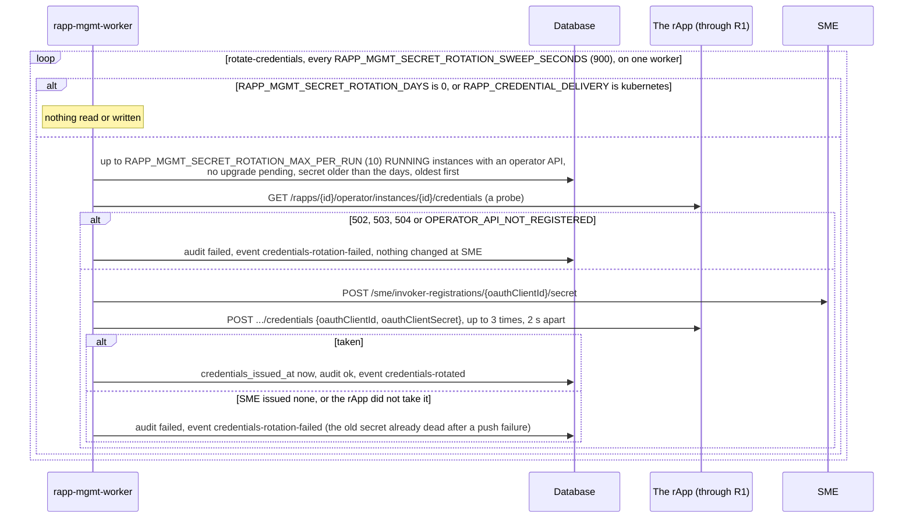
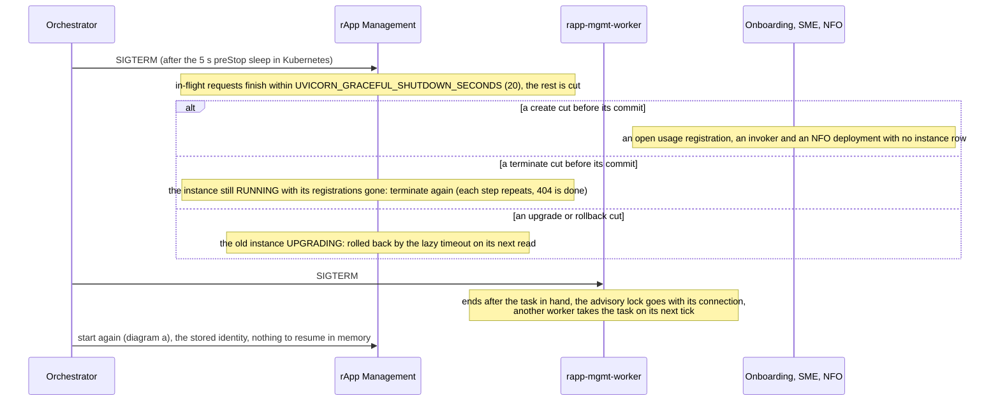

# rApp Management: lifecycle

rApp Management (the rApp Management SMOS) runs rApp instances: it creates one from an onboarded package with its own identity at SME, its workload at
NFO and its usage registration at Onboarding, puts its safeguards in force when it reports itself up, upgrades, rolls back and tears it down. It is served
behind R1 Termination at `/rapp-mgmt`, keeps its tables (`rapp_instance`, `rapp_instance_version`, `rapp_fault_report`, `rapp_performance_report`) in
the database schema `rapp_mgmt`, connects as the role `smo_rapp_mgmt`, and runs a second process from the same image, `rapp-mgmt-worker`. The design is
in its [README](../README.md); the instance flows are call flows [01](../../docs/call-flows/01-rapp-onboarding-to-deployment.md) and
[07](../../docs/call-flows/07-rapp-instance-lifecycle.md). This document follows the module itself. Six diagrams:

| | Step | Who starts it | Ends with |
|---|---|---|---|
| a | Starting and becoming ready | the orchestrator | the service answering `/ready` 200, the worker ticking, one identity at SME for both |
| b | Creating an instance and handing over its credentials | Operator (GUI), an SMO module | an instance DEPLOYING with identity, workload and usage registration, its rApp holding the credentials |
| c | Coming up, reporting, faulting | the rApp (as its instance), Operator (GUI) | the instance RUNNING with its safeguards, FAULTED, or DEPLOYING again |
| d | Upgrading, rolling back, terminating | Operator (GUI), SA SMOS, the rApp | one surviving instance, or an UNDEPLOYED one with every registration gone |
| e | The worker: rotating secrets | `rapp-mgmt-worker` | due instances with a new secret their rApp holds, or the failure recorded |
| f | Stopping, crashing and recovering | the orchestrator, a crash | requests finished or rolled back, what a cut request left behind |

**How to read the diagrams.** As in call flow 01: an arrow is one call with the inputs that matter, a box on the receiver says what it does with them,
an `alt` block is the outcome (success first, then each failure and what the caller gets). Every call reaches rApp Management through R1 Termination,
which stamps the caller's role and invoker id; an rApp may change only its own instance's `bootstrap-complete`, `performance`, `fault` and
`operator-api` (R1's allow-list, and `NOT_THIS_INSTANCE` here). rApp Management's own calls go through R1 with the module's token (`R1Client`).

## a — Starting and becoming ready

The worker has no HTTP port and no `/ready`; it shares the service's identity row, so the two are one invoker at SME (PR-ST-4), registered by whichever
needs it first. Nothing is registered at start: the SME provider and services, the DME producer and the RAN NF OAM safeguards are per instance, made at
bootstrap (diagram c).

## b — Creating an instance and handing over its credentials

The secret is never stored: it goes to the rApp's operator API (01c), or with `RAPP_CREDENTIAL_DELIVERY=kubernetes` to a Secret
`rapp-<instanceId>-credentials`, or, failing both, nowhere, and the operator re-sends it (01e). `POST /instances/{id}/credentials` instead makes a new
identity, only while DEPLOYING. With an `Idempotency-Key` a repeated create returns the first answer (PR-ST-3); one still running is 409
`IDEMPOTENCY_KEY_IN_PROGRESS`. The create publishes no event: the instance's first event is its first transition.

## c — Coming up, reporting, faulting

The safeguards are fail-closed (AI-10.2, AI-11.4): an instance does not run without the limits its package declares. The SME declarations are
best-effort unless `RAPP_MGMT_REQUIRE_SME_REGISTRATION` is on (the production values). A bootstrap refused with 503 can be called again; the pushes are
repeated. The kill switch (`PUT`/`DELETE /instances/{id}/kill`, `/kill-all`) is kept by RAN NF OAM on the `oauthClientId`; rApp Management only
forwards it and answers 503 when RAN NF OAM cannot be told (call flow 07d). **Phase 1:** an rApp that never reports stays DEPLOYING until terminated.

## d — Upgrading, rolling back, terminating

Every NFO or Onboarding refusal during a teardown is recorded in `lastTeardown` and never blocks it (a 404 counts as done). The order inside the
transition matters: the deregistrations read `oauthClientId`, the revocation clears it, and the kill switch goes last so the instance is never free to
write in between (call flow 07e). **Phase 1:** there is no scheduler for `upgradeTimeoutSeconds`: an overdue upgrade is rolled back by the next request
that reads either instance, including `GET /instances`; an upgrade nobody reads stays UPGRADING.

## e — The worker: rotating secrets

Each instance is read again just before its turn and committed on its own, so a run cut halfway leaves the rest due for the next. No secret is logged,
audited or published (SEC-15.19). The worker also runs the two shared tasks every worker runs: `outbox-sweep` every `SMO_OUTBOX_SWEEP_SECONDS` (5) over
the whole `notification_outbox` (rApp Management itself enqueues no notification; it sweeps for the modules that do) and `event-purge` every
`SMO_EVENT_PURGE_SECONDS` (300), which drops events older than `SMO_EVENT_RETENTION_HOURS` (24).

## f — Stopping, crashing and recovering

What a cut create leaves is not swept: an administrator releases the usage registration (Onboarding asks here and finds no instance), terminates
the deployment at NFO, and SME's stale-invoker purge (`POST /sme/invoker-registrations/purge-stale`, on demand) removes the invoker. A reservation of
an `Idempotency-Key` left by a dead replica is taken over after `IDEMPOTENCY_IN_PROGRESS_SECONDS` (300), and the create may then run a second time.
Credentials committed but not pushed are re-sent by hand (01e). Replicas share nothing in memory: `rapp_instance` is versioned, so a stale write is
409 `CONCURRENT_MODIFICATION` (PR-ST-2), and of two replicas sweeping the same overdue upgrade one commits the rollback. **Phase 1:** no lock
serialises concurrent upgrade and resolve calls on one instance beyond that row version.

## Configuration it reads

| Variable | Default | What it changes |
|---|---|---|
| `SMO_DATABASE_URL`, `SMO_DATABASE_PASSWORD_FILE` | none (required) | the database and the role `smo_rapp_mgmt` |
| `R1_GATEWAY_URL` | `http://r1-termination:8000` | where every other module and the rApps' operator APIs are reached |
| `SMO_ENROLLMENT_SECRET_FILE` | compose secret | makes the module's own invoker `internal` (instances are registered without it) |
| `SMO_IDENTITY_KEY` (`_FILE`) | empty | encrypts the stored module identity; a wrong value stops the service and the worker |
| `RAPP_CREDENTIAL_DELIVERY` (and `RAPP_K8S_*`) | `none` | `kubernetes`: credentials written to a Secret per instance, and no automatic rotation |
| `RAPP_MGMT_REQUIRE_SME_REGISTRATION` | `false` | `true`: a bootstrap whose SME declarations are not all registered is refused |
| `RAPP_MGMT_SECRET_ROTATION_DAYS` | `0` | worker: rotate secrets older than this; 0 is off |
| `RAPP_MGMT_SECRET_ROTATION_MAX_PER_RUN` | `10` | worker: instances rotated per run |
| `RAPP_MGMT_SECRET_ROTATION_SWEEP_SECONDS` | `900` | worker: interval of `rotate-credentials`, read at the worker's start |
| `SMO_WORKER_TICK_SECONDS`, `SMO_WORKER_FAILURE_BACKOFF_SECONDS` | `5`, `30` | worker: tick, and the pause after a task failed |
| `IDEMPOTENCY_IN_PROGRESS_SECONDS`, `IDEMPOTENCY_KEY_TTL_SECONDS` | `300`, `86400` | when a create's key is taken over, and how long its answer is replayed |
| `UVICORN_GRACEFUL_SHUTDOWN_SECONDS` | `20` | how long a stop lets requests finish |

## Decisions this module depends on

- **One identity per instance** (PR-SEC-14, PR-SEC-10.3): registered at create with the instance's scope claim; the limits, kill switch, approval
  policy and audit key on it. The module's own identity is shared by its service and worker replicas (PR-ST-4).
- **An instance is not created without its usage registration and its workload** (call flows 06 and 15b, DOC-CF-1.4); what a failed create made is taken
  away again.
- **Credentials are pushed, never stored** (call flow 01c); rotation on a schedule is off by default (SEC-15.19).
- **The safeguards are put in force at bootstrap, fail-closed** (AI-10.2, AI-11.4); a crash keeps them, a terminate drops them (DOC-CF-1.3).
- **An upgrade is two instances**, its timeout enforced lazily, history kept in `rapp_instance_version` (OI-1-sa-rollback, call flow 07b, 07c).
- **Terminate and delete are separate**, terminate legal from FAULTED and DEPLOYING (HISTORY.md §5, OI-2-lcm-error-mapping).
- **Periodic work runs only in the worker**, once per interval across replicas (PR-MSG-4, PR-ST-8); a create is idempotent with a key (PR-ST-3).
