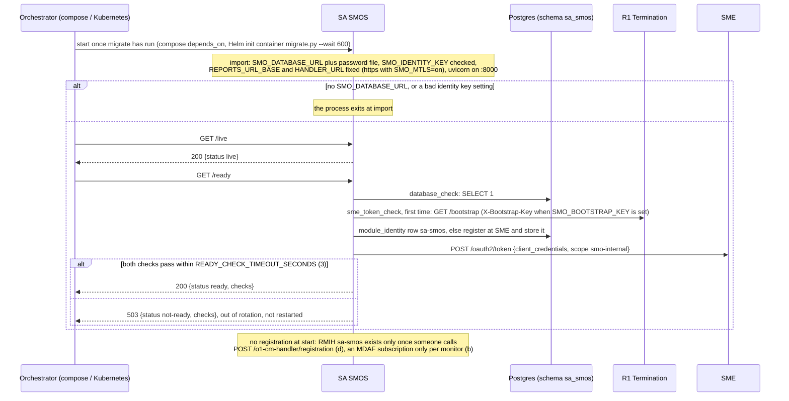
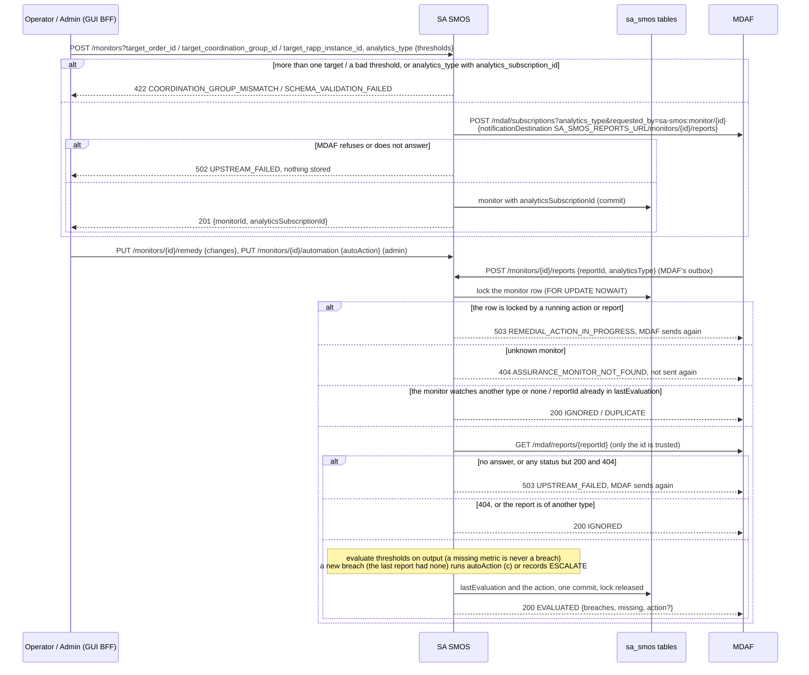
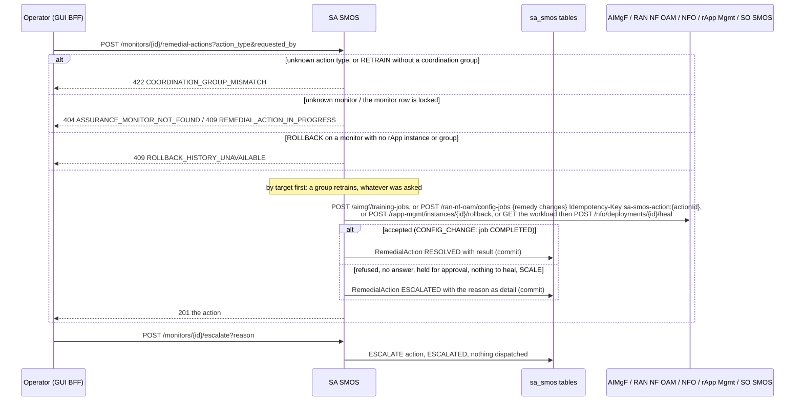
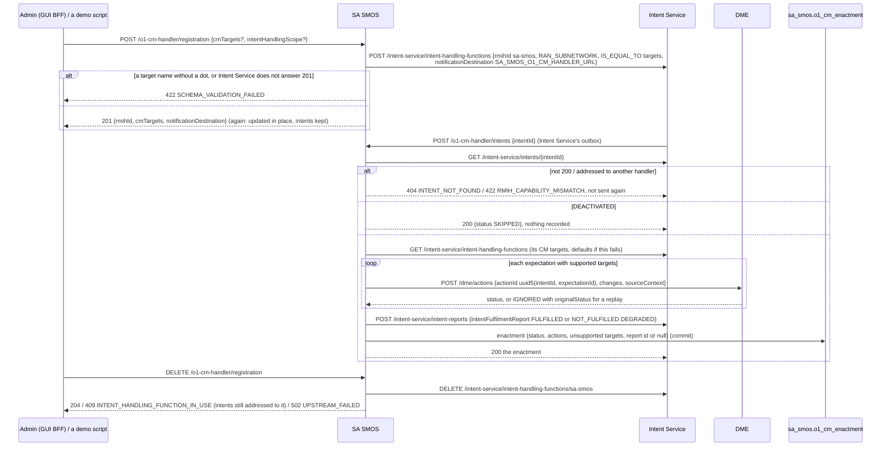
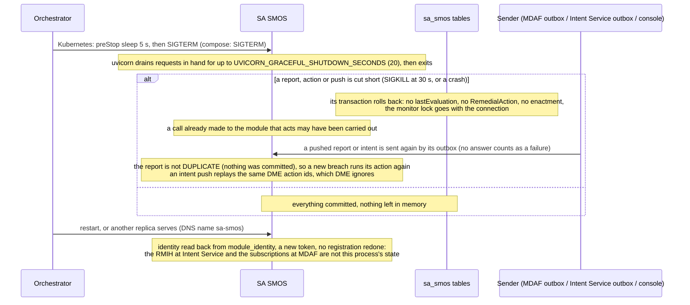

# SA SMOS: lifecycle

SA SMOS (Service Assurance SMOS) has two independent roles: it keeps assurance monitors, evaluates the MDAF reports pushed to them and runs or escalates a
remedial action (call flow 04), and it is the O1-CM intent handling function `sa-smos` that enacts Intent Service intents as O1 configuration changes
(call flow 09c). It is reached at the R1 prefix `/sa-smos`, keeps `assurance_monitor`, `remedial_action` and `o1_cm_enactment` in the database schema
`sa_smos` (login role `smo_sa_smos`), and has no worker, no outbox and no scheduled task: it acts only when called or pushed to. Nothing polls.
Design record: [`../README.md`](../README.md). Five diagrams:

| | Step | Who starts it | Ends with |
|---|---|---|---|
| a | Starting and becoming ready | the orchestrator (docker compose, Kubernetes) | a replica answering `/ready` 200; nothing registered |
| b | Monitors and the reports MDAF pushes | Operator / Admin (GUI BFF); MDAF's notification outbox | a monitor subscribed at MDAF, each report evaluated once |
| c | Remedial actions and escalation | Operator (GUI BFF), or b | one RemedialAction, RESOLVED or ESCALATED |
| d | The O1-CM intent handler | Admin (GUI BFF) or a demo; Intent Service's outbox | RMIH `sa-smos` registered, an intent written through DME and reported on |
| e | Stopping, crashing and recovering | the orchestrator, a crash | requests drained, or redone when their sender sends again |

**How to read the diagrams.** As in call flow 01: an arrow is one call with the inputs that matter, a box on the receiver says what it does with them,
an `alt` block is the outcome (success first, then each failure and what the caller gets). The console reaches SA SMOS through R1 Termination; MDAF's and
Intent Service's pushes come straight to the addresses SA SMOS registered (`SA_SMOS_REPORTS_URL`, `SA_SMOS_O1_CM_HANDLER_URL`), not through R1. Every
call SA SMOS makes goes through `R1Client` with its own module token; an rApp may change nothing at SA SMOS (R1's allow-list has no `/sa-smos` entry).

## a — Starting and becoming ready

The identity, token cache and probes are the shared ones, described for SO SMOS in [its lifecycle](../../so-smos/docs/lifecycle.md) (a): one invoker per
module in `module_identity`, registered with the enrollment secret so SME records it as `internal`. Both callback addresses are read once at import, so
a changed `SA_SMOS_REPORTS_URL` applies to monitors registered after the restart; existing MDAF subscriptions keep the address they were made with.

## b — Monitors and the reports MDAF pushes

The monitor lock is taken with `NOWAIT`, so a second report or action never queues behind a slow one: MDAF's outbox retries a 5xx with its backoff and
the next delivery finds `DUPLICATE` once the first has committed. An evaluation that outlasts the outbox's 2 s send timeout is sent again the same way. The
lock is held while SA SMOS reads the report and runs the action. Details in
[call flow 04](../../docs/call-flows/04-closed-loop-assurance.md) (04a, 04b). **Phase 1:** there is no route to delete a monitor, so its MDAF subscription
stays until it is deleted at MDAF; the subscription is made before the monitor is committed, so a commit that fails leaves one at MDAF with no monitor.

## c — Remedial actions and escalation

A refusal or silence from the module that acts is an outcome, never an HTTP error of SA SMOS: the action is ESCALATED and `GET /remedial-actions?outcome=ESCALATED`
is the operator's queue. RECONNECT finds the workload through rApp Management's version history or through the order's COMPLETED DEPLOY step at SO SMOS.
The per-type rules are [call flow 04](../../docs/call-flows/04-closed-loop-assurance.md) (04c, 04d).

## d — The O1-CM intent handler

The action id is derived from the intent and the expectation, so an intent pushed twice (the outbox delivers at least once) is written once: DME answers
the replay IGNORED and the first outcome decides the report. A transport error to Intent Service or DME is not caught: the push answers 500, nothing is
recorded, and Intent Service's outbox sends it again. Flow in [call flow 09](../../docs/call-flows/09-intent-service-intent-flow.md) (09c).
**Phase 1:** a push that is enacted twice still records two enactments and publishes two reports; only `IS_EQUAL_TO` targets on `RAN_SUBNETWORK` are enacted.

## e — Stopping, crashing and recovering

Replicas share nothing but the database: the monitor row lock serialises reports and actions across them, and pushes to `sa-smos:8000` land on any
replica. A console request cut short ends in an error: the operator sees no action in the queue and asks again. **Phase 1:** the `Idempotency-Key` of a
CONFIG_CHANGE is made from a fresh action id each time, so it guards only `R1Client`'s own retry after a 401; a report re-delivered after a crash writes
the remedy again under a new key.

## Configuration it reads

| Variable | Default | What it changes |
|---|---|---|
| `SMO_DATABASE_URL` (or `_FILE`), `SMO_DATABASE_PASSWORD_FILE` | none: the process does not start | The database; compose and Helm connect as `smo_sa_smos` |
| `SA_SMOS_REPORTS_URL` | `http://sa-smos:8000` (https with mTLS) | The base MDAF is told to push a monitor's reports to, read at start |
| `SA_SMOS_O1_CM_HANDLER_URL` | `http://sa-smos:8000/o1-cm-handler/intents` | The `notificationDestination` registered at Intent Service, read at start |
| `R1_GATEWAY_URL` | `http://r1-termination:8000` | Every outbound call (MDAF, Intent Service, DME, the modules that act) |
| `SMO_HTTP_TIMEOUT_SECONDS` | 30 | How long one outbound call may take; past it a report answers 503 and an action is ESCALATED |
| `SMO_DB_STATEMENT_TIMEOUT_MS`, `SMO_DB_IDLE_IN_TRANSACTION_TIMEOUT_MS` | 30000, 300000 | Session limits; the monitor lock is held across outbound calls, inside the second |
| `SMO_BOOTSTRAP_KEY`, `SMO_ENROLLMENT_SECRET_FILE`, `SMO_INVOKER_ID` / `_SECRET` | unset | The SME identity, as for every module ([SO SMOS lifecycle](../../so-smos/docs/lifecycle.md)) |
| `SMO_IDENTITY_KEY` (or `_FILE`), `SMO_IDENTITY_PREVIOUS_KEY` | unset | Encrypts the stored invoker secret; a bad setting stops the process at start |
| `READY_CHECK_TIMEOUT_SECONDS` | 3 | How long `/ready` waits for the database and SME checks |
| `UVICORN_WORKERS`, `UVICORN_GRACEFUL_SHUTDOWN_SECONDS` | 1, 20 | Server processes per container, and the drain on SIGTERM |
| `SMO_MTLS` | off | `on`: serves and calls with mTLS, and both callback addresses become `https://` |

## Decisions this module depends on

- **The loop closes on MDAF's reports** (DOC-CF-1.8, call flow 04b): a monitor with an analytics type is subscribed at MDAF; a pushed report is read back by
  id, evaluated once (`DUPLICATE` after), and only a new breach acts.
- **The automatic action is an admin's** (call flow 04): it must suit the target, SCALE is never automatic (OI-7-nfo-scale-size), ROLLBACK needs a
  rApp-instance monitor (HISTORY.md OI-1-sa-rollback).
- **One action per monitor at a time**: the monitor row lock, `NOWAIT`, 409 for the console and 503 for MDAF's outbox so that it retries.
- **A refusal is an outcome** (DOC-CF-1.8): no false RESOLVED; a refused, silent or held action is ESCALATED with the reason.
- **The O1-CM handler** (HISTORY.md W8-07, decision D-1): registered on request, never at start; re-registering updates in place and a handler with intents
  is not removed (call flow 09c); writes go through DME's action mediation with ids derived from the intent (W10-18).
- **One SME identity per module** (PR-ST-4), **separate liveness and readiness** (PR-ST-7), **its own schema and role** (PR-DB-2.6, revision 0024).
