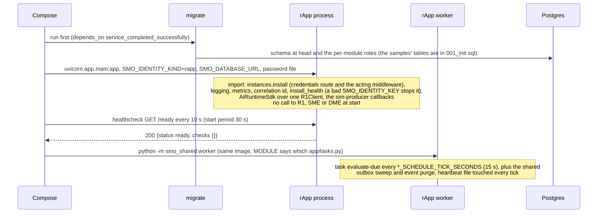
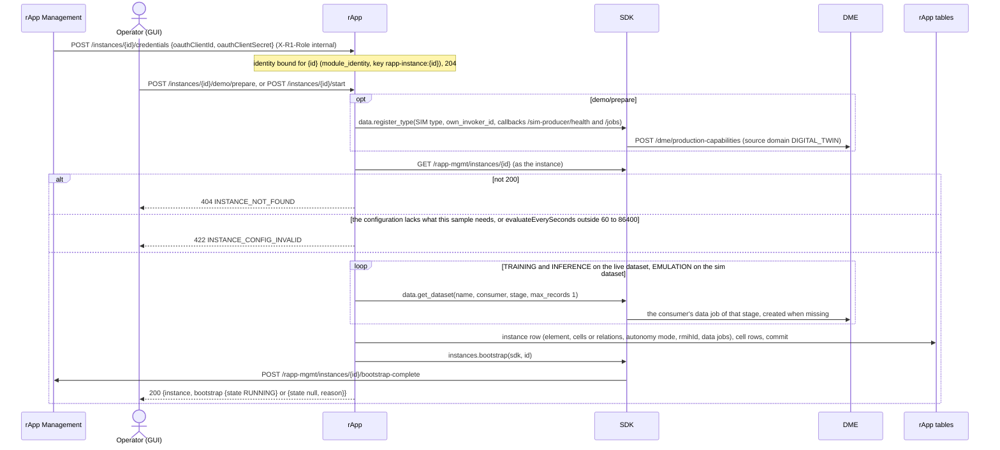
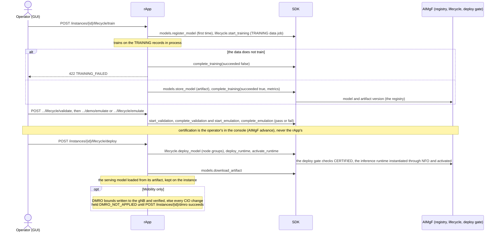
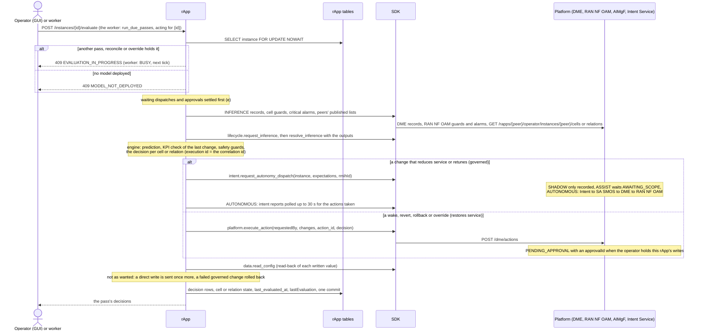
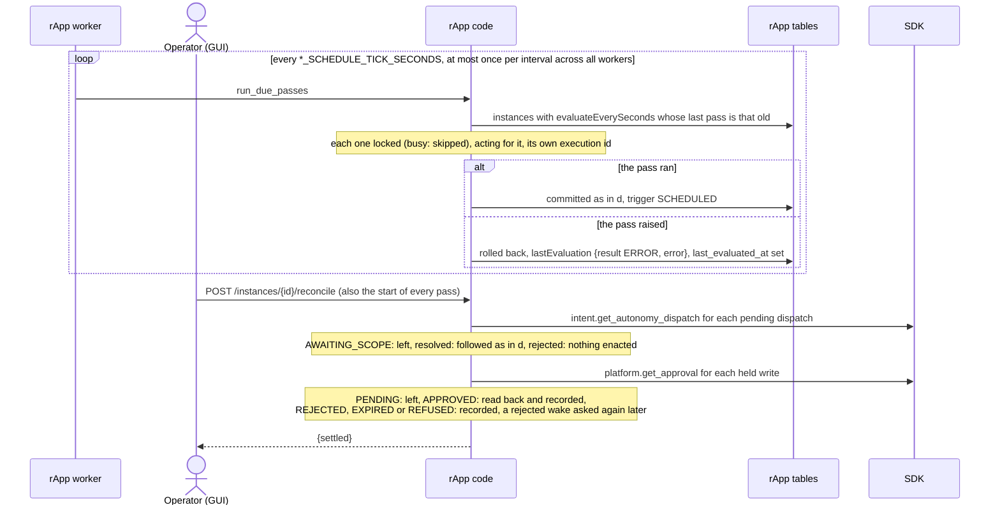
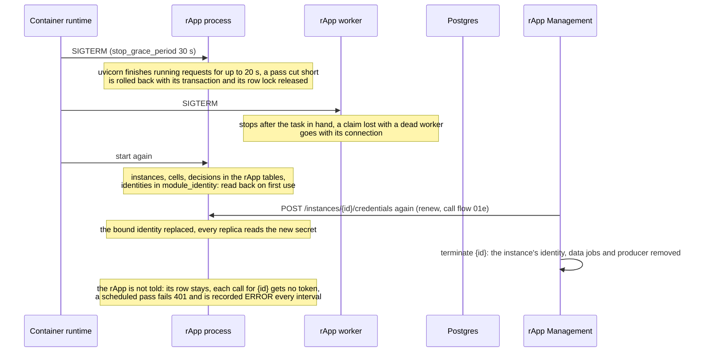

# Sample rApps: lifecycle of an instance

The four sample rApps under `samples/` (Energy Saving, Mobility Optimization, Coverage Optimization, Traffic Steering) are built the same way on
the Python SDK ([`../../sdk/docs/lifecycle.md`](../../sdk/docs/lifecycle.md)): one FastAPI process serves every instance of its package (its
operator API on port 8000), a worker process of the same image runs the scheduled passes, and every platform call goes through R1 Termination as the
instance. This document follows one instance from the rApp's point of view; where a sample differs, it says so. Packages and their pages:
[`../README.md`](../README.md) and each sample's README. Six diagrams:

| | Step | Who starts it | Ends with |
|---|---|---|---|
| a | Starting the rApp and becoming ready | the container (uvicorn), the worker container | serving `/live`, `/ready` and the operator API; no platform call yet |
| b | Receiving and starting an instance | rApp Management (credentials), Operator (GUI) ("Prepare and start") | the instance stored with its three data jobs, reported RUNNING |
| c | The model's lifecycle | Operator (GUI): Train, Validate, Emulate, Deploy | a model registered, trained, certified by the operator and serving |
| d | One pass of the closed loop | Operator (GUI) ("Evaluate now"), the worker | each cell or relation decided, written, verified, audited |
| e | Waiting work: dispatches, approvals, the schedule | the worker, Operator (GUI) ("Reconcile") | a held write settled, a scheduled pass run or recorded as failed |
| f | Stopping and recovering | SIGTERM, a restart, rApp Management | the instances and their identities read back from the database |

**How to read the diagrams.** As in [call flow 01](../../docs/call-flows/01-rapp-onboarding-to-deployment.md): an arrow is one call with the inputs that
matter, a box on the receiver says what it does with them, an `alt` block is the outcome (success first, then each failure and what the caller gets).
*Operator (GUI)* is a button on the rApp's declared page: the console calls the BFF, which allows only the routes the package's `operatorUi` declares
and calls R1's `/rapps/{instanceId}/operator/...`, which R1 sends to the instance's registered operator API base (the operator's `operatorApiBase`, else
the package's `operatorApi.baseUrl`, `http://<sample>:8000`). *SDK* is `smo_sdk` with its `R1Client`; every SDK arrow goes through R1 with the
instance's token, which is not drawn.

## a — Starting the rApp and becoming ready

The process is ready as soon as it answers: `install_health(app)` is called with no checks, so `/ready` does not look at the database or SME. The
rApp's own identity at SME is made on its first platform call (SDK a), under `rapp:samples/<sample>` in the shared `module_identity` table, so every
replica of the rApp process and of its worker uses one invoker. Calls outside any instance (`/sim-producer/register`, `/sim-producer/publish`) carry that
identity.

**Phase 1:** NFO starts no workload: each sample runs as a fixed compose service (or Helm deployment) serving every instance of its package, which is
why an instance's credentials are pushed to it ([call flow 01](../../docs/call-flows/01-rapp-onboarding-to-deployment.md)).

## b — Receiving and starting an instance

The start is idempotent: a second call updates the row and reuses the data jobs, and its `bootstrap` part says `409 ...` once the instance is RUNNING.
What each sample requires of the instance configuration: Energy Saving `managedElementRef`, `cells`, an `actuator` of `ADMINISTRATIVE_STATE` or
`ENERGY_SAVING_CONTROL`; Mobility `managedElementRef`, `relations [{relation, source, target}]`, optional `baselineCio`, `dmroBounds`; Coverage
`managedElementRef`, `cells`, optional `baselineTilt`, `baselinePower`; Traffic Steering `managedElementRef`, `cells [{cellId, layer}]`, optional
`baselineCio`, `baselinePriority`. The three datasets are `PRB_UTILIZATION`, `HO_PERFORMANCE`, `COVERAGE_PERFORMANCE` and `LOAD_PERFORMANCE` and their
`_SIM` twins. The peer instance ids (`energySavingInstanceId`, `mobilityInstanceId`, `trafficSteeringInstanceId`, `coverageInstanceId`) are read here too.
In detail: [call flow 01d](../../docs/call-flows/01-rapp-onboarding-to-deployment.md). **Phase 1:** a configuration changed at rApp Management
reaches the rApp only at the next `start` ([call flow 07e](../../docs/call-flows/07-rapp-instance-lifecycle.md)).

## c — The model's lifecycle

An SDK error inside these routes is answered with the platform's status and body (a 5xx as 502). The model lifecycle in full is
[call flow 02](../../docs/call-flows/02-aiml-model-train-to-inference.md); the runtime is [call flow 17](../../docs/call-flows/17-model-runtime-lifecycle.md).

## d — One pass of the closed loop

A pass is one transaction holding the instance's row lock, so its SDK calls (the intent report wait included) run while it is held. A platform error
in the middle of a pass rolls the pass back. What the samples differ in: Energy Saving locks or wakes cells (`administrativeState` or
`energySavingControl`) and also reads MDAF's prediction, any MDAF failure ignored; Mobility tunes `cellIndividualOffset` per relation and keeps clear of
relations Traffic Steering observes; Coverage moves up to two cells' tilt or power jointly; Traffic Steering moves reselection priority or CIO per source
cell and publishes its relations for Mobility. The other three confirm a change or revert it at the KPI check of a later pass (the demo's `kpi-hour`).
Detail: call flows [22](../../docs/call-flows/22-energy-saving-closed-loop.md), [23](../../docs/call-flows/23-mobility-optimization-closed-loop.md),
[24](../../docs/call-flows/24-coverage-optimization-closed-loop.md), [25](../../docs/call-flows/25-traffic-steering-closed-loop.md).

## e — Waiting work: dispatches, approvals, the schedule

A failed scheduled pass is retried after the instance's interval, not at every tick, and never stops the other instances. The worker has no port; its
health is the heartbeat file (unhealthy after a minute). The demo buttons (`demo/prepare`, `demo/history`, `demo/emulate`, `demo/live`, and
`demo/kpi-hour` for the other three) are declared admin-only on the page; they make the rApp play the network, sending PM reports to RAN NF OAM in chunks
of 96 measurements (R1 must allow it, `R1_DEMO_RAPP_PM_REPORTS=on`) and publishing the Digital Twin's records to every data job of its sim type.

## f — Stopping and recovering

Recovery needs nothing of the rApp: every pass reads what is due from the database and every write carries its own action id, so a pass cut by a
stop is simply run again. A write held for approval when the rApp stopped is settled by the next reconcile.

**Phase 1:** nothing tells a sample that its instance was terminated, reconfigured or stopped (the kill switch is enforced at RAN NF OAM, which
refuses the instance's writes, [call flow 07d](../../docs/call-flows/07-rapp-instance-lifecycle.md)).

## Configuration it reads

| Variable | Default | What it changes |
|---|---|---|
| `SMO_IDENTITY_KIND` | `module` (compose and the chart set `rapp`) | Registers the process as an rApp at SME, scope `smo-rapp` |
| `R1_GATEWAY_URL` | `http://r1-termination:8000` | Where every platform call goes |
| `SMO_BOOTSTRAP_KEY[_FILE]` | unset | The key R1's `/bootstrap` asks for when `R1_BOOTSTRAP_KEY` is set |
| `SMO_DATABASE_URL`, `SMO_DATABASE_PASSWORD_FILE` | none (the process refuses to start without a URL) | The rApp's tables and the identity store, as its own Postgres role |
| `SMO_IDENTITY_KEY[_FILE]` | unset | Encrypts the stored instance secrets; the rApp process and its worker need the same key |
| `ENERGY_SAVING_SCHEDULE_TICK_SECONDS`, `MOBILITY_`, `COVERAGE_`, `TRAFFIC_STEERING_SCHEDULE_TICK_SECONDS` | `15` | How often the worker looks for due instances (at least 1 s, read once) |
| `SMO_WORKER_TICK_SECONDS`, `SMO_WORKER_FAILURE_BACKOFF_SECONDS` | `5`, `30` | The worker's loop and its back-off after a failed task |
| `SMO_HTTP_TIMEOUT_SECONDS` | `30` | Each call through R1 (hence the 96-measurement PM chunks) |
| `UVICORN_GRACEFUL_SHUTDOWN_SECONDS` | `20` | How long a stopping process finishes running requests |
| Instance configuration `evaluateEverySeconds` | absent (no schedule) | 60 to 86400: the instance's scheduled pass |

## Decisions this module depends on

- **R1 only, through the SDK** (golden rule 6): never another module's database; an rApp acts at SME only as itself (DOC-CF-1.8, call flow 18).
- **One identity per instance, pushed and kept in `module_identity`** ([call flow 01c to 01e](../../docs/call-flows/01-rapp-onboarding-to-deployment.md),
  PR-ST-4, SEC-15.18); the rApp reports its instance up itself.
- **What reduces service is governed, what restores it goes straight to DME** (`HISTORY.md` Wave 10, decision D-2 for the actuator, D-4 for the
  convenience calls): autonomy modes SHADOW / ASSIST / AUTONOMOUS (OI-6.3); a held write is followed, never sent twice (PR-AI-11); every write
  carries a decision record (PR-AI-13).
- **Read after write, then rollback** (W10-20, W10-21); **Digital Twin data never feeds inference** (decision D-7).
- **One pass at a time per instance, periodic work in a worker** (call flows 22e to 25f, PR-MSG-4).
- **Coordination through each other's published lists** (GUI-8.3, the shared CIO D10.4-1).
