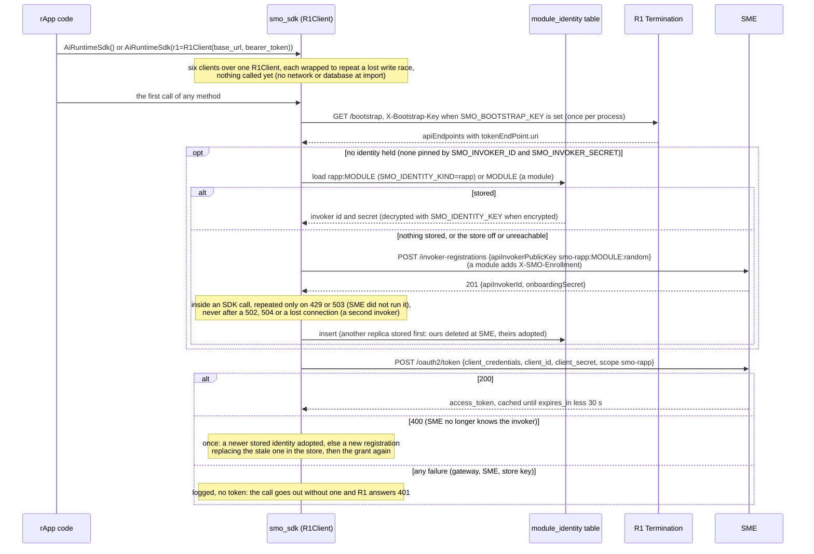
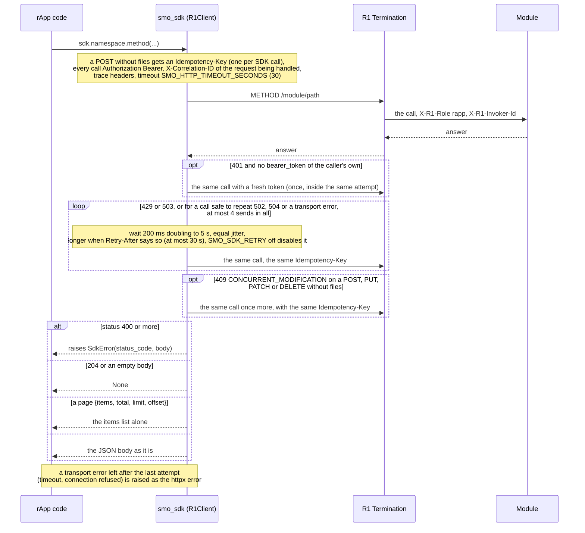
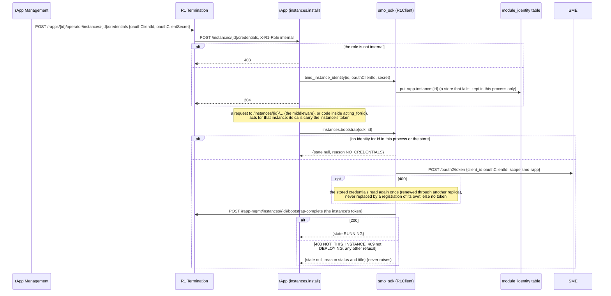
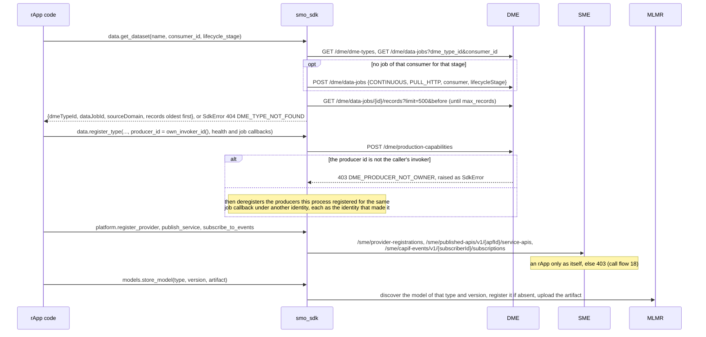
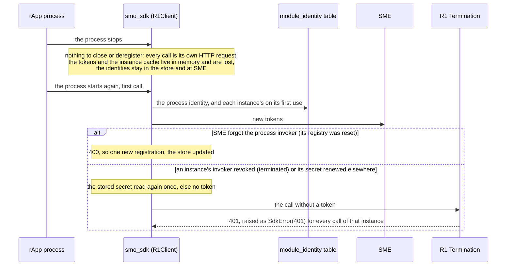

# AI Runtime SDK (smo_sdk): lifecycle

The Python SDK (`smo_sdk`) is the library an rApp imports to reach the platform: six namespace clients (`data`, `analytics`, `models`, `lifecycle`,
`intent`, `platform`) over one `smo_shared.r1_client.R1Client`, which gets the rApp its identity and token at SME and sends every call through R1
Termination. It has no port, no table and no thread of its own; what it keeps, it keeps in the rApp's process and in the shared `module_identity`
table. Its methods are in [`../README.md`](../README.md); this document follows what the SDK does for an rApp from the first call to the last. Five diagrams:

| | Step | Who starts it | Ends with |
|---|---|---|---|
| a | The process identity and the first token | the rApp's first SDK call | an invoker at SME (stored once for every replica) and a cached token, or no token |
| b | One call | any SDK method | the decoded answer, `None`, a plain list, or `SdkError` |
| c | Acting for an instance | rApp Management (the credentials), the rApp (`/instances/{id}/...`, a worker pass) | calls carrying the instance's own token; the instance reported up |
| d | What an rApp registers and creates through it | the rApp's code | data jobs, a DME producer, SME services, models; each reused or deduplicated where the SDK can |
| e | Stopping and recovering | the rApp process ending, SME or rApp Management changing an identity | identities read back from the store; a refused one gives `SdkError(401)` |

**How to read the diagrams.** As in [call flow 01](../../docs/call-flows/01-rapp-onboarding-to-deployment.md): an arrow is one call with the inputs
that matter, a box on the receiver says what it does with them, an `alt` block is the outcome (success first, then each failure and what the caller
gets). Every call to a module goes through R1 Termination, which introspects the token at SME and stamps the caller's role (`rapp` for an rApp) and
invoker id; it is drawn in b and left out elsewhere. `/bootstrap`, the registration and the token endpoint are reached without a token.

## a — The process identity and the first token

An rApp (`SMO_IDENTITY_KIND=rapp`, as the sample rApps' compose entries set) registers without the enrollment secret, so SME records it as an rApp and
the token's scope is `smo-rapp`; a module asks for `smo-internal`. One identity and one token per process, shared by the six clients; with the store on
(`MODULE` set, `SMO_MODULE_IDENTITY_STORE` not `off`) every replica and every restart of the rApp uses the same invoker. A store that cannot be reached
is not fatal: the process registers on its own, logs a warning, and leaves one more registration at SME for its stale-invoker purge. The SDK has no
probe of its own; an rApp built on it adds `/live` and `/ready` with `smo_shared.health.install_health`.

## b — One call

The SDK adds no validation and no business rule: the module's refusal is the answer, as `SdkError` with its real status and body. The 409 repeat is
safe because the platform rolled the first attempt back, and the shared key lets a module that did complete the first attempt answer the repeat from
it (PR-ST-2, PR-ST-3). Transient failures are repeated with backoff, the Go and Java SDKs' policy (SDK-PY-RETRY, [`../README.md`](../README.md) 2.5): safe calls (GET, PUT, DELETE, a keyed POST) after a transport error or 502/504, every call after 429/503, a call with `files` never; the 409 repeat gets its own retry budget. The unwrapped list drops `total`, so a caller
cannot see that a list was cut at the route's default limit.

## c — Acting for an instance

One rApp process may serve several instances, and each instance has its own invoker, scope claim, limits, kill switch and approval policy at the
platform (call flows [01c, 01d and 01e](../../docs/call-flows/01-rapp-onboarding-to-deployment.md)). Outside an instance, or for an instance whose
credentials were never pushed, a call carries the process's own identity. `instances.is_bound(id)` and `instances.invoker_of(id)` say what is held;
`sdk.data.own_invoker_id()` is the invoker the calls carry now (the instance's while acting for it).

## d — What an rApp registers and creates through it

Nothing the SDK creates is torn down by the SDK: an instance's data jobs, producers, services and policies go when rApp Management terminates the
instance ([call flow 07e](../../docs/call-flows/07-rapp-instance-lifecycle.md)). The few calls that deduplicate do so by looking first (`get_dataset`,
`store_model`, `register_type`'s clean-up) or by a key the module keeps (`platform.execute_action(action_id=...)`, which DME answers `IGNORED` when
re-sent). `lifecycle.advance_model_lifecycle` is kept but always raises `SdkError(403)` without a call: the governance events are the operator's.

## e — Stopping and recovering

A rApp loses nothing it cannot rebuild: the identities are in the database, and everything else the SDK did is state at the modules. The one thing
the SDK cannot repair is an instance identity SME no longer accepts; only rApp Management can issue a new one (re-send the credentials, 01e).

**Parity with the Go and Java SDKs.** `sdk-go` ([README](../../sdk-go/README.md)) and `sdk-java` ([README](../../sdk-java/README.md)) follow the same
road: `/bootstrap` with the bootstrap key, registration at SME, a `client_credentials` token refreshed before expiry and once on a 401, an
`Idempotency-Key` on every POST reused by its repeats, one repeat of a `409 CONCURRENT_MODIFICATION`, and the module's error as one error type. All three repeat transient failures with the same backoff (4 attempts, 200 ms doubling to 5 s, `Retry-After` up to 30 s; this SDK follows
Go's equal jitter, and only this SDK reads its policy from the environment, `SMO_SDK_RETRY*`). They differ in two ways: they have typed helpers for fewer routes (Java has no `analytics`,
`lifecycle` or `intent` yet); and they hold one identity per process, either pinned by `SMO_INVOKER_ID` / `SMO_INVOKER_SECRET` (the instance's, never
replaced on a 400, where this SDK's process identity is) or enrolled by the process, with no credentials route and no switching between instances.

## Configuration it reads

| Variable | Default | What it changes |
|---|---|---|
| `R1_GATEWAY_URL` | `http://r1-termination:8000` | Where every call and `/bootstrap` go (`https://` with `SMO_MTLS=on`) |
| `SMO_IDENTITY_KIND` | `module` | `rapp`: registers without the enrollment secret, asks `smo-rapp`, stores under `rapp:MODULE` |
| `MODULE` | set by the image | The key of the stored identity; without it the identity is per process |
| `SMO_MODULE_IDENTITY_STORE` | `db` | `off`: every process registers its own invoker |
| `SMO_IDENTITY_KEY[_FILE]` | empty | Encrypts the stored secrets (the replicas need the same key; a bad key stops `install_health` at start) |
| `SMO_INVOKER_ID`, `SMO_INVOKER_SECRET` | unset | A pre-provisioned process identity instead of the stored one |
| `SMO_BOOTSTRAP_KEY[_FILE]` | unset | Sent as `X-Bootstrap-Key` when R1 asks for it |
| `SMO_ENROLLMENT_SECRET[_FILE]` | unset | Sent at registration by a module only, never by an rApp |
| `SMO_HTTP_TIMEOUT_SECONDS` | `30` | The timeout of every call through R1 |
| `SMO_MTLS` and `SMO_MTLS_*_FILE` | `off` | The client certificate on every call |
| `SMO_DATABASE_URL`, `SMO_DATABASE_PASSWORD[_FILE]` | none | The database of the identity store (the rApp's own connection) |

## Decisions this module depends on

- **The SDK is a thin client over R1, not a second road** (golden rule 6 of `docs/ARCHITECTURE.md`): one method per route, no validation of its own.
- **Who the caller is** (PR-SEC-14): an rApp registers without the enrollment secret and is held to R1's rApp allow-list (`RAPP_MAY_CHANGE`).
- **One identity per module, shared by replicas** (PR-ST-4); **encrypted at rest** (SEC-15.18).
- **One identity per rApp instance, pushed by rApp Management** ([call flow 01c to 01e](../../docs/call-flows/01-rapp-onboarding-to-deployment.md)),
  never replaced by a registration of the process's own.
- **A lost write race is repeated once, with an idempotency key** (PR-ST-2, PR-ST-3).
- **A producer only under its own invoker id** (SEC-15.10b), hence `own_invoker_id()` and the clean-up in `register_type`.
- **The bootstrap key** (PR-SEC-9.3); **the execution-mode convenience calls** (`HISTORY.md` W10-03, decision D-4).
