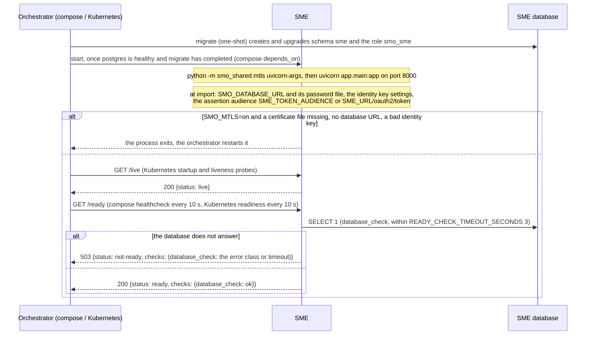
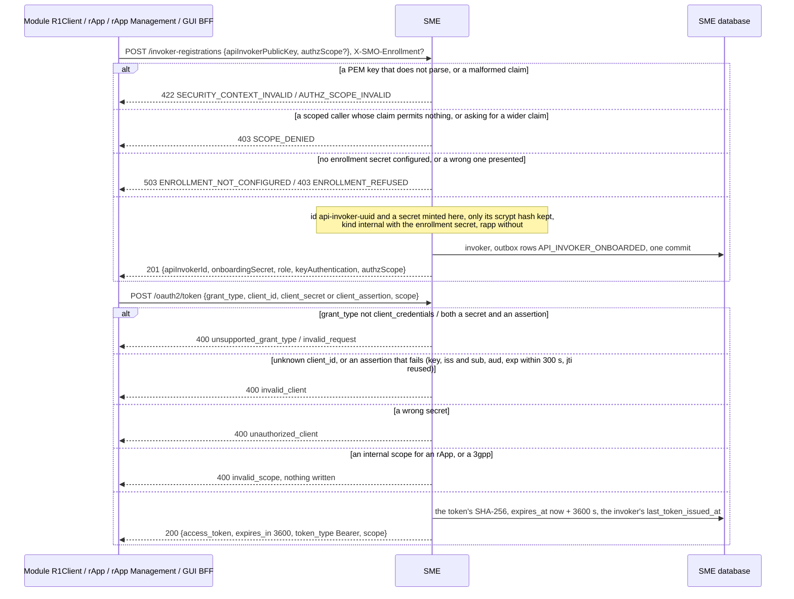
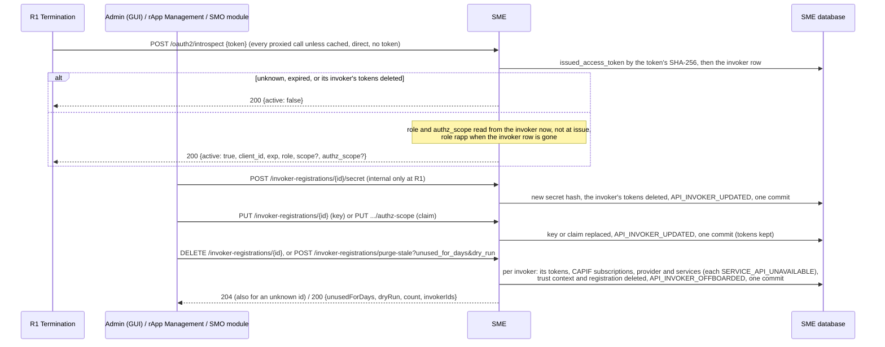
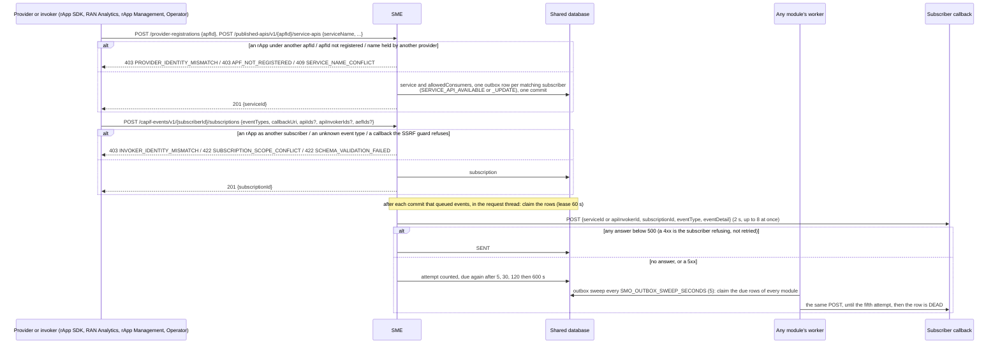
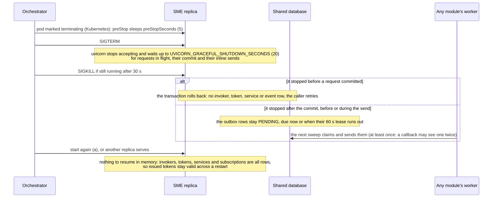

# SME: lifecycle

SME (Service Management and Exposure) is the CAPIF core of this SMO (TS 29.222): it onboards API invokers and providers, issues the bearer tokens every
caller presents at R1 Termination, answers R1's introspection of those tokens on every call, keeps the published service APIs and their discovery, and
tells event subscribers of each change. It is reached at `/sme` through R1 Termination (container `:8000`), except its token endpoint and introspection,
which are not behind the token check. Its tables are in the database schema `sme` (role `smo_sme`), plus the shared `notification_outbox` and
`module_identity` (`migrations/db_roles.json`). Design record: [README](../README.md); the security flows in full: call flow
[18](../../docs/call-flows/18-sme-trusted-invokers-lifecycle.md). Five diagrams:

| | Step | Who starts it | Ends with |
|---|---|---|---|
| a | Starting and becoming ready | the orchestrator (compose, Kubernetes) | a process that answers `/ready` once its database does |
| b | Onboarding an invoker and issuing its token | every module's `R1Client`, an rApp, rApp Management, the GUI BFF | an invoker with a server-minted id and secret, and a token for a checked scope |
| c | Introspection and revocation | R1 Termination on every call; Admin, rApp Management | the caller's role and scope claim, or `active: false` once its tokens are gone |
| d | Publishing, discovery and subscriptions, and the events they cause | providers, invokers, Operator (GUI) | services and subscriptions stored, each change queued as events in the same commit |
| e | Stopping, crashing and recovering | the orchestrator, a crash | nothing half-done: a request commits whole or not at all, a queued event is sent by a worker |

**How to read the diagrams.** As in call flow 01: an arrow is one call with the inputs that matter, a box on the receiver says what it does with them,
an `alt` block is the outcome (success first, then each failure and what the caller gets). Calls through R1 carry the caller's role (`X-R1-Role`) and
invoker id; an rApp acts at SME only as itself (call flow 18). Every route is one transaction: the change and the outbox rows of its events commit together.

## a — Starting and becoming ready

SME has no identity of its own and registers nothing: it holds the invoker registry, so it never onboards at itself, and it calls no other module (its
only outbound calls are event callbacks, d). It is the dependency of everyone else's readiness: the `/ready` of most modules includes `sme_token_check`, which
fails until that module has a token from SME.

The enrollment secret (`SMO_ENROLLMENT_SECRET` or its `_FILE`, the compose secret `enrollment_secret`) is read on each registration, not at start: SME starts
without it, and every registration is then 503 `ENROLLMENT_NOT_CONFIGURED` (b), so no module becomes ready. `SME_ALLOW_OPEN_ENROLLMENT` (labs and unit tests
only) makes every invoker `internal` instead.

## b — Onboarding an invoker and issuing its token

A module meets SME this way on its first call or its first `/ready` (`smo_shared/r1_client.py`): it reads the token endpoint from R1's `/bootstrap`, adopts
the identity its replicas share in `module_identity` or registers one with the enrollment secret, and asks for the scope `smo-internal` (an rApp for
`smo-rapp`). It keeps the token until 30 s before it expires. A 400 from the token endpoint makes it register afresh once, so a module whose invoker SME
no longer knows (offboarded, purged, a reset registry) recovers by itself. Registration and the token request go to the address `/bootstrap` advertises (SME's own on the container
network), not through the gateway's token check; the other invoker routes go through R1.

Every registration mints a new invoker, so a caller that loses the 201 and retries leaves an orphan that only the purge (c) removes.

## c — Introspection and revocation

A token stops being active only when it expires (3600 s) or its invoker's tokens are deleted: a new secret, offboarding, or the purge. There is no
per-token revocation. R1 may cache an answer (`R1_INTROSPECTION_CACHE_SECONDS`, 30 s in compose and the chart), so a revocation is seen there within that
time; the replica that carried a `DELETE` or an `authz-scope` change forgets the invoker at once (`r1-termination/docs/lifecycle.md`, b). Introspection
answers 200 for every token; a database that cannot be read is a 5xx, which R1 turns into 503 `AUTH_SERVICE_UNAVAILABLE` for its caller.

The purge offboards every invoker that has taken no token for `unused_for_days` days (or never did and was onboarded that long ago), one commit per
invoker; `dry_run` defaults to true and only lists them. Nothing schedules it: an operator calls it. Unknown ids to the key, secret and claim routes are 400
`INVOKER_NOT_REGISTERED`. **Phase 1:** expired tokens are never deleted, and expired `used_client_assertion` rows only when the next client assertion is
checked.

## d — Publishing, discovery and subscriptions, and the events they cause

The details of providers, discovery (`GET /service-apis/v1/allServiceAPIs`, only what the invoker may see) and the identity rules are call flow 18a and
18e. A service event goes only to subscribers whose filters match and who may see the service (`allowedConsumers`); invoker events (onboarded, updated,
offboarded, from b and c) have no visibility gate. Deleting a service, a provider or an invoker queues `SERVICE_API_UNAVAILABLE` before the rows go.

The send after the commit runs inside the request, so a publish answers only after its callbacks answered or timed out. SME has no worker of its own: the
retries are the shared outbox sweep, which every module worker runs over the whole `notification_outbox` table (`dme-worker`, `ran-nf-oam-worker` and the
others in `docker-compose.yml`). **Phase 1:** a stack with no worker running never retries a failed first send; DEAD rows are kept, SENT rows are deleted
after `SMO_OUTBOX_SENT_RETENTION_SECONDS` (one day).

## e — Stopping, crashing and recovering

A caller that lost its answer retries: for a registration that makes a second invoker (b); a token request just issues another token; a publish of the same
`serviceName` by the same provider updates in place. While SME is down R1 answers 503 `AUTH_SERVICE_UNAVAILABLE` with `Retry-After: 5`, not 401, so a
caller has no reason to drop a token that is still good.

**Several replicas** (`docker-compose.replicas.yml`, two): SME keeps no state in memory, so any replica answers any call, and the outbox claim makes sure
one sender sends each row. A client assertion's `jti` is remembered in `used_client_assertion`, shared by all replicas, so an assertion replayed to another
replica is refused too (two at the same instant: the second commit fails on the key and is answered 409 `RESOURCE_ALREADY_EXISTS` by the shared
handler, not `invalid_client`).

## Configuration it reads

| Variable | Default | What it changes |
|---|---|---|
| `SMO_DATABASE_URL`, `SMO_DATABASE_PASSWORD_FILE` | none (required) | SME's database, as role `smo_sme`; read at import |
| `SMO_ENROLLMENT_SECRET` / `SMO_ENROLLMENT_SECRET_FILE` | unset | What makes an invoker `internal`; read on each registration, both set is an error, unset makes registration 503 |
| `SME_ALLOW_OPEN_ENROLLMENT` | off | With no enrollment secret, registers everyone as `internal` (labs, unit tests) |
| `SME_TOKEN_AUDIENCE` | `<SME_URL>/oauth2/token` | The `aud` a client assertion must name; compose sets `<R1_PUBLIC_BASE_URL>/sme/oauth2/token` when that is set. Read at start |
| `SME_URL` | `http://sme:8000` | The base of the default audience |
| `SMO_ROLE_ENFORCEMENT` | `enforce` | `audit` grants `smo-internal` / `smo-gui` to an rApp with a warning instead of `invalid_scope` |
| `READY_CHECK_TIMEOUT_SECONDS` | `3` | How long `/ready` waits for the database |
| `SMO_OUTBOX_INLINE_DRAIN` | `true` | `false` leaves every event send to the workers' sweep |
| `SMO_OUTBOX_SEND_CONCURRENCY` | `8` | Callbacks one drain sends in parallel |
| `SMO_OUTBOX_SWEEP_SECONDS`, `SMO_OUTBOX_SENT_RETENTION_SECONDS` | `5`, `86400` | Read by the workers: how often failed sends are retried, how long SENT rows are kept |
| `SMO_MTLS` | `off` | `on`: serves HTTPS with client certificates, upgrades the default audience to `https://`, refuses to start without its files |
| `UVICORN_GRACEFUL_SHUTDOWN_SECONDS` | `20` | How long a stopping process waits for requests in flight |

## Decisions this module depends on

- **The server mints identity** (TS 29.222, HISTORY.md §2 and §7): the invoker id and the secret come from SME, only the secret's hash is kept, and the
  enrollment secret alone makes an invoker `internal` (PR-SEC-14).
- **A scope is checked before a token is issued** (OI-2-oauth2-scope), and an rApp never gets an internal scope (PR-SEC-14); a PEM key makes RFC 7523
  client assertions a credential (SA-SME-1-public-key).
- **Opaque tokens, introspected** (call flow 18d): role and scope claim are read at introspection, so a change applies to tokens already issued
  (PR-SEC-10.3); revocation is by invoker, not by token.
- **An rApp acts at SME only as itself, and nothing outlives what it belongs to** (DOC-CF-1.8, call flow 18a, 18b, 18e).
- **Events through the transactional outbox** (PR-MSG-1.6): written in the change's transaction, sent after it commits, retried by the workers' sweep
  (PR-MSG-2), at least once.
- **One identity per module, shared by its replicas, and a purge for the leftovers** (PR-ST-4).
- **Probes and stopping** (PR-ST-7, PR-ST-6): `/ready` checks the database only; `/live` checks nothing.
