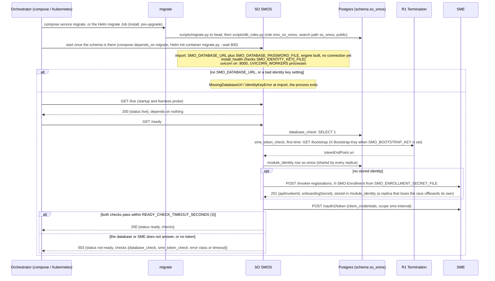
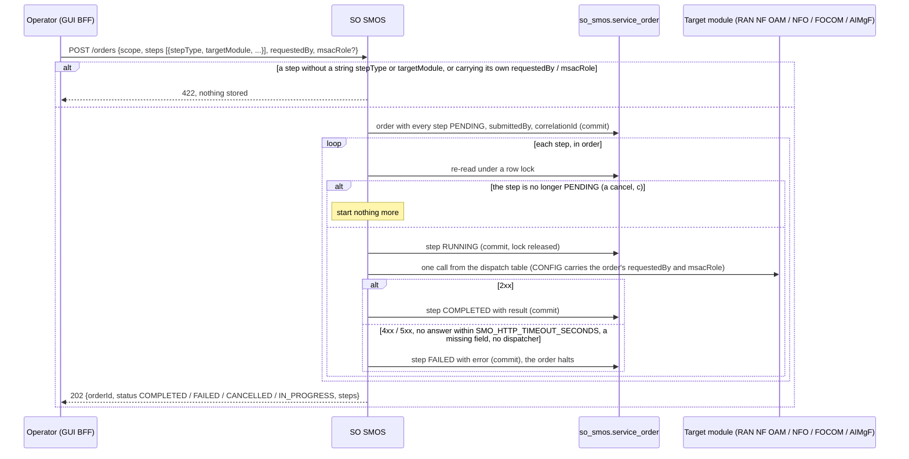
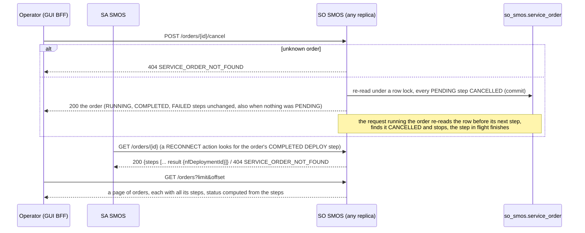
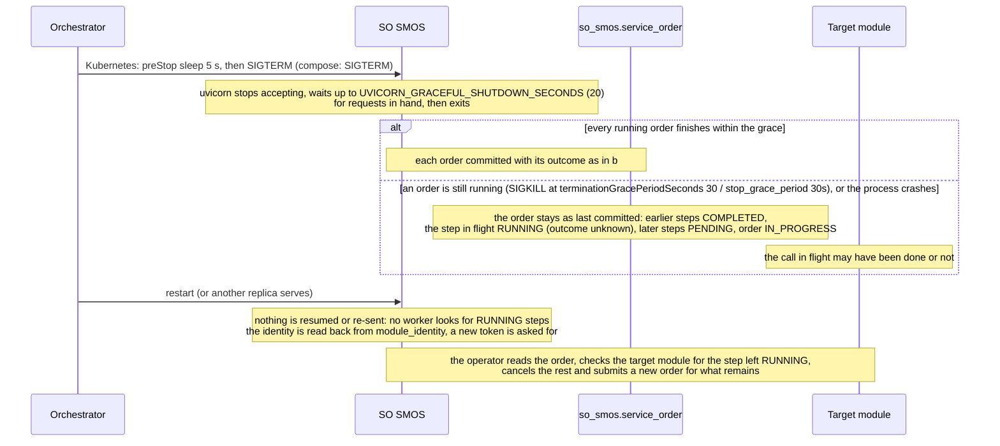

# SO SMOS: lifecycle

SO SMOS (Service Orchestration SMOS) runs a service order: an ordered list of steps, each one call through R1 Termination to the module that performs
it (RAN NF OAM, NFO, FOCOM, AIMgF), first failure halts the order. It is reached at the R1 prefix `/so-smos`, keeps its one table `service_order` in the
database schema `so_smos` (login role `smo_so_smos`), and has no worker, no outbox and no scheduled task: everything it does happens inside a request.
Design record: [`../README.md`](../README.md). This document follows the module through its life. Four diagrams:

| | Step | Who starts it | Ends with |
|---|---|---|---|
| a | Starting and becoming ready | the orchestrator (docker compose, Kubernetes) | a replica answering `/ready` 200, with its SME identity and a token |
| b | Running an order | Operator (GUI BFF) | every step's outcome committed one by one, the order answered 202 |
| c | Reading and cancelling while it runs | Operator (GUI BFF), SA SMOS | the PENDING steps CANCELLED, the running order stopping before its next step |
| d | Stopping, crashing and recovering | the orchestrator, a crash | in-flight orders finished or left with one step RUNNING, nothing resumed |

**How to read the diagrams.** As in call flow 01: an arrow is one call with the inputs that matter, a box on the receiver says what it does with them,
an `alt` block is the outcome (success first, then each failure and what the caller gets). Calls reach SO SMOS through R1 Termination, which checks the
caller's token; an rApp may change nothing at SO SMOS (R1's allow-list has no `/so-smos` entry). Every call SO SMOS makes goes out through `R1Client`
with its own module token.

## a — Starting and becoming ready

SO SMOS registers nothing at SME beyond its invoker identity: it publishes no service and subscribes to nothing. The identity is obtained lazily, by the
first `/ready` probe or the first outbound call, whichever comes first, and the token is cached until 30 s before it expires. A failing `/ready` takes the
replica out of rotation (Kubernetes readiness every 10 s, three failures; compose healthcheck every 10 s, five retries) and never restarts it; only
`/live` does, and it depends on nothing. `SMO_INVOKER_ID` and `SMO_INVOKER_SECRET` pin a provisioned identity instead of the stored one.

## b — Running an order

The order runs in the request thread, so the 202 comes after the last step; no lock and no transaction is held during a call to another module. The
dispatch table, the fail-fast rule and what COMPLETED means for each step are [call flow 10](../../docs/call-flows/10-so-smos-multi-step-infra-training-deploy.md)
(10a, 10b, 10d). A step whose call timed out is FAILED here even if the module did the work late: SO SMOS never asks again.

**Phase 1:** a caller that stops waiting (R1 answers 504 `UPSTREAM_TIMEOUT` after `R1_UPSTREAM_TIMEOUT_SECONDS`, 60 s) does not stop the order; it keeps
running and `GET /orders/{id}` shows it. There is no compensation of completed steps, no resume and no retry (`OPEN_ITEMS.md` SO-RESUME, SO-WAIT, SO-CHAIN).

## c — Reading and cancelling while it runs

The cancel and the running submit may be on different replicas: both write `steps` under `SELECT ... FOR UPDATE`, so neither loses the other's change.
The order's status is not stored; it is computed on every read. Details in [call flow 10](../../docs/call-flows/10-so-smos-multi-step-infra-training-deploy.md)
(10c) and, for SA SMOS's read, [call flow 04](../../docs/call-flows/04-closed-loop-assurance.md) (04c).

## d — Stopping, crashing and recovering

There is nothing in memory to lose: an order's state is the committed row, the identity is the shared `module_identity` row, and the token is fetched
again. Any number of replicas can run (`docker-compose.replicas.yml` and `deploy/helm/smo/ci/ha-values.yaml` run two); they share nothing but the database. A replica
that SME no longer recognises (token grant answered 400) registers afresh once and replaces the stored identity with a compare-and-swap, and the other
replicas adopt it. **Phase 1:** a step left RUNNING stays so for ever (`OPEN_ITEMS.md` SO-RESUME); see [call flow 10](../../docs/call-flows/10-so-smos-multi-step-infra-training-deploy.md) (10b).

## Configuration it reads

| Variable | Default | What it changes |
|---|---|---|
| `SMO_DATABASE_URL` (or `_FILE`) | none: the process does not start | The database; compose and Helm connect as `smo_so_smos` |
| `SMO_DATABASE_PASSWORD_FILE` | unset | The password put into the URL (`/run/secrets/db_password_so-smos` in compose) |
| `SMO_DB_POOL_SIZE`, `SMO_DB_MAX_OVERFLOW` | 5, 10 | Connections kept and allowed per process (per uvicorn worker) |
| `SMO_DB_STATEMENT_TIMEOUT_MS`, `SMO_DB_IDLE_IN_TRANSACTION_TIMEOUT_MS` | 30000, 300000 | Session limits (not sent with `SMO_DB_POOLER` set) |
| `R1_GATEWAY_URL` | `http://r1-termination:8000` | Where every step's call and the bootstrap go |
| `SMO_HTTP_TIMEOUT_SECONDS` | 30 | How long one step's call may take before the step is FAILED |
| `SMO_BOOTSTRAP_KEY` (or `_FILE`) | unset | Sent as `X-Bootstrap-Key` to `GET /bootstrap` when the gateway asks for one |
| `SMO_ENROLLMENT_SECRET_FILE` | unset | Presented at registration, so SME records the invoker as `internal` |
| `SMO_INVOKER_ID`, `SMO_INVOKER_SECRET` | unset | A provisioned SME identity instead of the shared stored one |
| `SMO_IDENTITY_KEY` (or `_FILE`), `SMO_IDENTITY_PREVIOUS_KEY` | unset | Encrypts the stored invoker secret; a bad setting stops the process at start |
| `SMO_MODULE_IDENTITY_STORE` | `db` | `off`: each process registers its own invoker instead of sharing one |
| `READY_CHECK_TIMEOUT_SECONDS` | 3 | How long `/ready` waits for the database and SME checks |
| `UVICORN_WORKERS`, `UVICORN_GRACEFUL_SHUTDOWN_SECONDS` | 1, 20 | Server processes per container, and the drain on SIGTERM |
| `SMO_MTLS` | off | `on`: serves and calls with mTLS, the gateway and token URLs become `https://` |

## Decisions this module depends on

- **Sequential and fail-fast, no compensation** (SO/SA SMOS LLD section 1.1, call flow 10): the first FAILED step halts the order, completed steps stay.
- **Saved step by step** (DOC-CF-1.8, call flow 10a, 10b): the order is committed before its first step and before and after each one, so it is readable
  while it runs and a crash leaves the step in flight RUNNING.
- **A cancel reaches a running order** (call flow 10c): cancel and submit both write `steps` under a row lock, and the submit re-reads before each step.
- **The submitter is the order's** (DOC-CF-1.8): `requestedBy` and `msacRole` are order fields, sent with every CONFIG step; a step may not carry them.
- **One SME identity per module** (PR-ST-4) and **separate liveness and readiness** (PR-ST-7): replicas share the `module_identity` row, and `/ready`
  checks the database and SME while `/live` checks nothing.
- **Its own schema and role** (PR-DB-2.6, revision 0024): `smo_so_smos` sees `so_smos` and the shared `module_identity` table only.
- **The correlation id is kept** (revision 0059, call flow 14b): the order stores the id of its submit, which every step's call carries.
