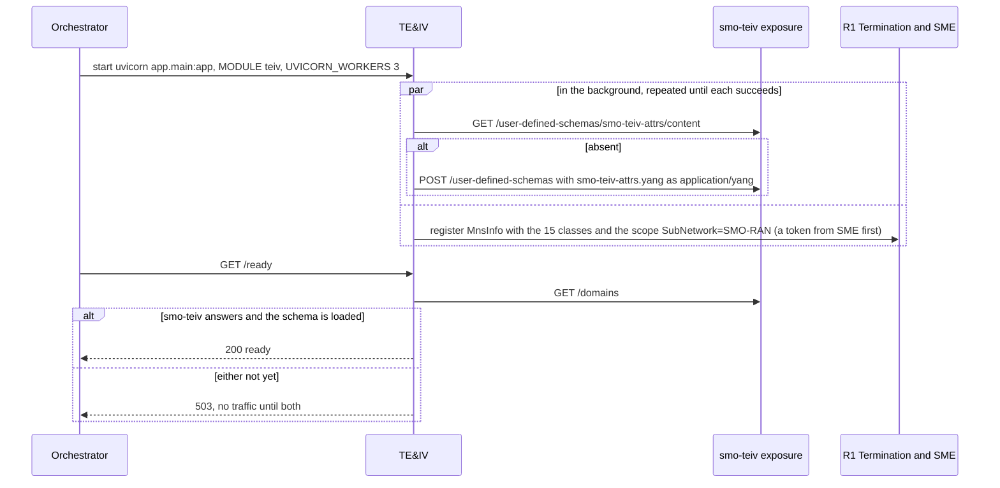
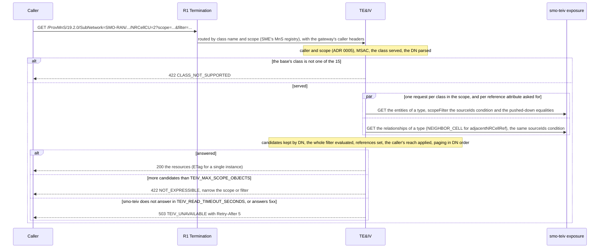
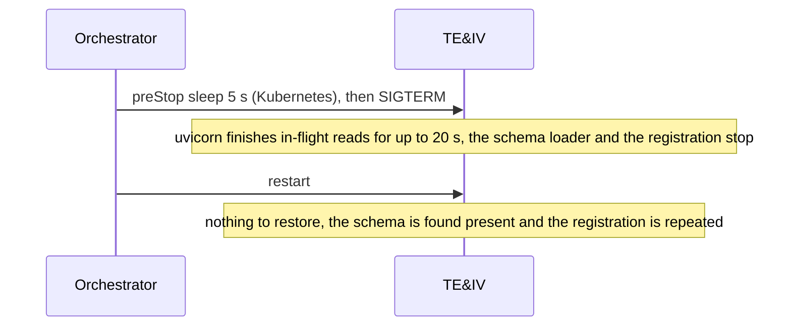

# TE&IV: lifecycle

TE&IV is the SMO's door to O-RAN-SC smo-teiv (plan tasks S3.19 to S3.21, D19): the shared ProvMnS router of `smo_shared.mns` read-only on smo-teiv's
exposure API, and the WG10 TE&IV R1 API passed to it. It keeps no state of its own: the topology is smo-teiv's, its writes are S3.4's. What its routes
do is in [`../README.md`](../README.md). Three diagrams:

| | Step | Who starts it | Ends with |
|---|---|---|---|
| a | Starting and becoming ready | the orchestrator (compose, Kubernetes) | a replica that answers `/live`, and `/ready` once smo-teiv answers and TE&IV's decorator schema is in it |
| b | A read (getMOIAttributes) | a caller of ProvMnS, through R1 by class name | the resources the scope and filter select, exactly, or a refusal with its reason |
| c | Stopping, crashing and recovering | the orchestrator, a crash | nothing to recover: TE&IV holds nothing between requests |

**How to read the diagrams.** As in the call flows: an arrow is one call with the inputs that matter, a box on the receiver says what it does with
them, an `alt` block is the outcome (success first, then each failure and what the caller gets).

## a — Starting and becoming ready

smo-teiv may start after TE&IV, and R1 Termination and SME too: each step is retried (1, 2, 5, 10, 30 s, then every 30 s) and logged, never fatal.
Until TE&IV is registered, R1 answers a ProvMnS read of its classes 404 `NO_ROUTE`.

## b — A read

A write (createMOI, modifyMOIAttributes, deleteMOI) takes the same checks, then the instance and its `If-Match` (412 `STALE_VERSION` with the current
ETag), and answers 501 `WRITE_NOT_AVAILABLE` until S3.4.

## c — Stopping, crashing and recovering

A read cut by the stop gets no answer, and the caller repeats it. A WG10 write cut after smo-teiv carried it out and before its audit row was
committed is in smo-teiv without its row; the caller sees no answer.

## Configuration it reads

| Variable | Default | What it changes |
|---|---|---|
| `TEIV_EXPOSURE_URL` | `http://teiv-exposure:8080` | smo-teiv's exposure process |
| `TEIV_CONNECT_TIMEOUT_SECONDS`, `TEIV_READ_TIMEOUT_SECONDS` | 2, 5 | how long it waits for smo-teiv |
| `TEIV_MAX_CONNECTIONS` | 32 | the connections kept to smo-teiv |
| `TEIV_MAX_SCOPE_OBJECTS` | 20000 | the most candidates of one class a read may fetch |
| `TEIV_MNS_SCOPE` | `SubNetwork=SMO-RAN` | the DNs registered as its MnS scope |
| `SMO_DATABASE_URL`, `SMO_DATABASE_PASSWORD_FILE` | set by compose and the chart | the audit trail of the WG10 writes |
